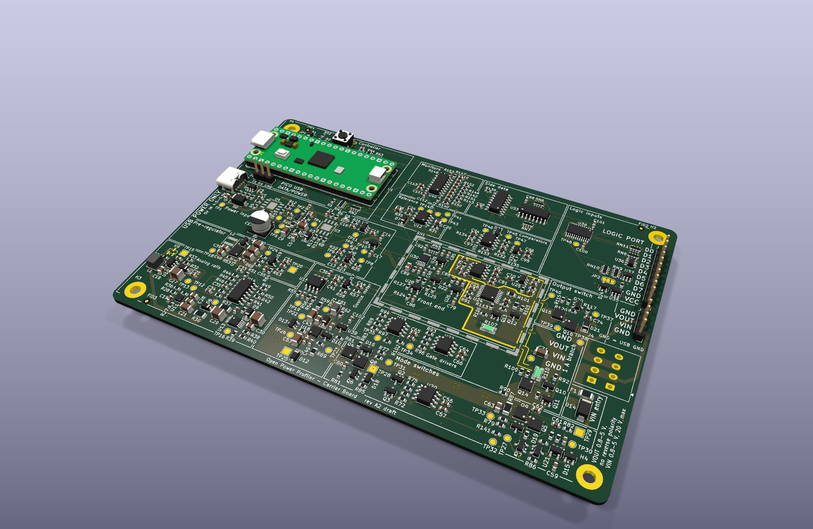
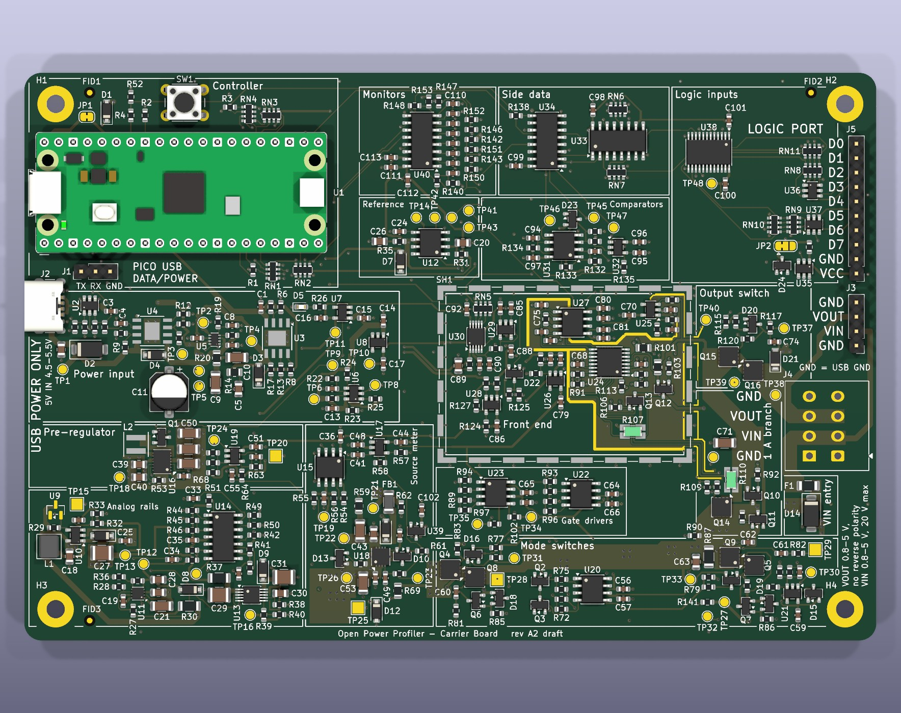
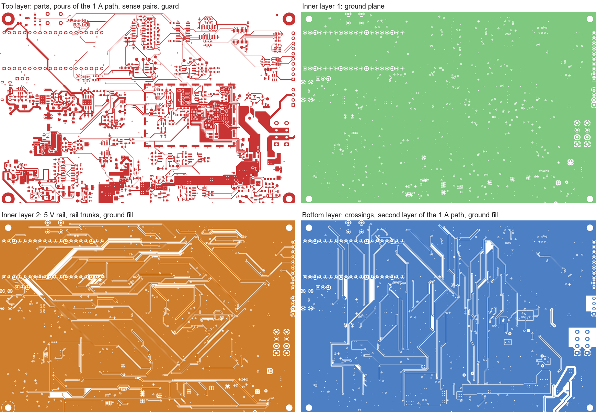
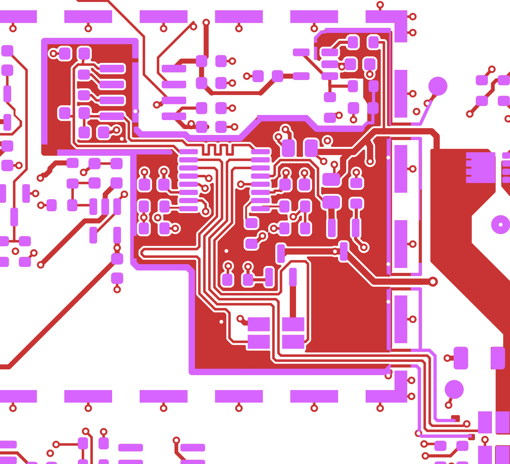
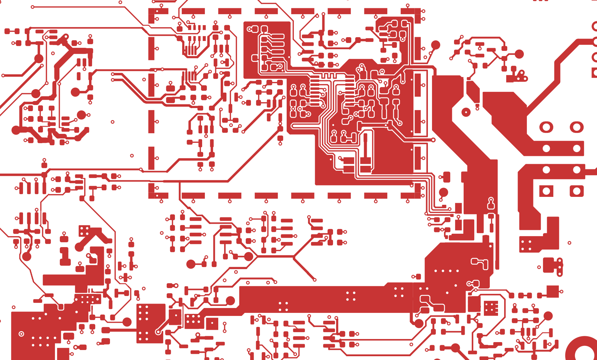
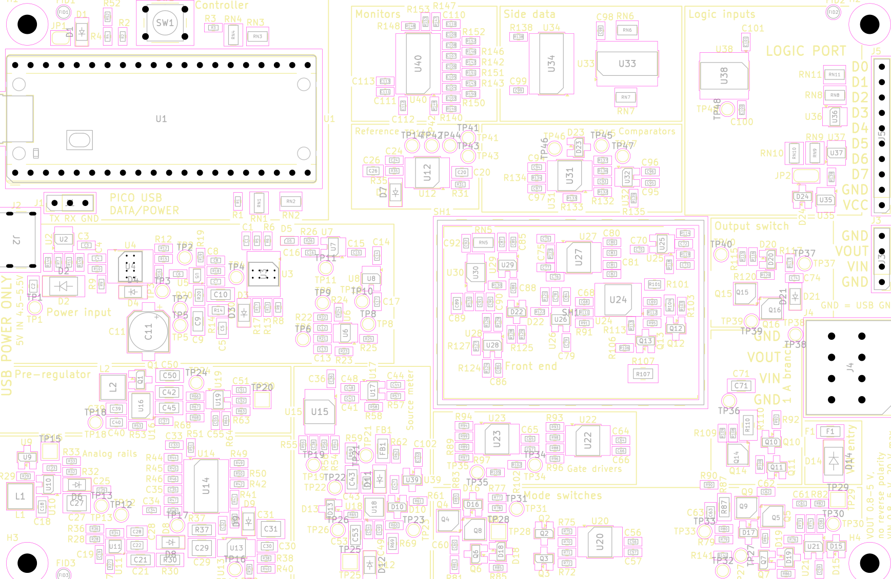

# Open Power Profiler

[![Checks: run on demand][badge-checks]](CONTRIBUTING.md#quality-gates)
[![Status: early development][badge-status]](#roadmap)
[![Software license: MIT][badge-mit]](LICENSE)
[![Hardware license: CERN-OHL-P v2][badge-ohl]](hardware/LICENSE)

Open-source power profiler in the class of the Nordic PPK2, built around the
Raspberry Pi Pico 2. It is designed to sample current at 100 kSPS from
100 nA to 1 A with automatic range switching, to work either as a source
meter that powers the device under test or as an ampere meter in series
with an external supply, and to stream the samples to a PC over USB.

The instrument is two boards: a Raspberry Pi Pico 2, bought ready-made,
plugged into a carrier board designed in this project that holds the
measurement electronics.



The picture is a rendering from the KiCad files of draft A2, with the
Pico 2 on its sockets. It is not a photograph: no board has been built.

> [!NOTE]
> The project is in early development. No hardware has been built and
> nothing has been measured. The performance figures in this repository
> are design targets, the circuits of the board are simulated from its
> netlist, and the figures of the board are calculated from the drawn
> copper. [Project Status](#project-status) says what exists, what it
> rests on and what comes next.

## Table of Contents

- [Project Status](#project-status)
- [Target Specifications](#target-specifications)
- [How It Works](#how-it-works)
- [Connections](#connections)
- [Hardware Draft](#hardware-draft)
- [Circuit Simulations](#circuit-simulations)
- [Repository Structure](#repository-structure)
- [Roadmap](#roadmap)
- [Getting Started](#getting-started)
- [Engineering Practices](#engineering-practices)
- [Documentation](#documentation)
- [Contributing](#contributing)
- [License](#license)
- [Acknowledgments](#acknowledgments)

## Project Status

As of 2026-10-13. Draft A2 of the carrier board is the present state of
the hardware: the whole schematic, a specification written for it, and a
board with every part placed and every one of its 984 connections drawn.
The board was first routed by an autorouter, which left 28 connections
open. Its layout has since been reviewed: the open connections are closed
and the copper that an autorouter does not draw is drawn, the pours of the
1 A path, the guard, the sense pairs and the copper of the converters. The
review was done with scripts and checked by independent calculation. The
seven points where the reviewed board departs from the first wording of
section 10 of the specification are recorded decisions, D-87 to D-93, and
the specification follows them.

On 2026-10-13 a person looked at the drawings for the first time: the
project owner opened the schematic and the board in the KiCad editor and
found both coherent. It was a look, not a review item by item, and no
edit was saved. The same day the footprints and the placement were
reviewed on a copy of the project, with scripts on the board file, 3D
renderings of every region of the board and the datasheets. Five findings
of that review were worked into the board at single points, with no new
routing, and the silkscreen got the frames and names of the functional
blocks
([Review of Footprints and Placement](#review-of-footprints-and-placement)).
What is open is the review of the board item by item in the KiCad
editor, a list of items that need parts moved, what the silkscreen and
the test points still lack, and the thermal check of D-93.
Every figure of the board is calculated from the drawn copper, none is
measured; the package in [`tools/board/`](tools/board/README.md)
reproduces them from the board file.

Later on 2026-10-13 the project owner asked for the files that are needed
to send the board to fabrication. The fabrication outputs of draft A2 are
filed in
[`hardware/fabrication/draft-a2/`](hardware/fabrication/draft-a2/README.md)
for an order of proof-of-concept boards: eleven Gerber files of the
four-layer board, two drill files and two files for machine assembly.
That is decision D-105 of the specification. The items that the
specification puts before an order are still open, boards made from
these files are draft A2 and not revision A, and those items stay open.
No order is recorded: no board has been ordered or made as far as the
repository shows.

On 2026-10-10 the circuits of the schematic were simulated as well, block
by block, from its netlist: 134 benches in ngspice, of which 93 run
circuits of the board and 41 put the models into the test circuits of
their datasheets. The central design figures of the specification come
out again. The simulations raised four points for a decision before
boards are ordered, and the project owner decided them the same day: they
are decisions D-95 to D-98 of the specification. Three of them are drawn
since that day, as changes of values, part numbers and texts that move no
copper: 10 nF at three capacitors of the rail monitor (D-95), the two
parts of the damper on the module input fitted (D-98), and the text of
the detector position at the boost converter, which stays without a part
(D-97). The schematic, the board, the bill of materials and the netlist
snapshot of the simulations hold them, and the electrical rules check and
the design rules check report nothing on these files (run again on
2026-10-13).
The fourth is not drawn: a position for a capacitor at the buffer of the
driver rail (D-96), which needs a footprint and copper. The simulations
were not run again, so their results are still those of the circuit
before the three changes.

In fourteen places the simulations differed from a figure or a rule of
the specification or showed something that it did not state. The owner
asked for the text to follow the simulations: twelve places are corrected
in the specification, three of them by decisions D-99 to D-101, two wait
for the run of the benches on the drawn decisions, and seven questions
that the corrections leave are open, each with one recommendation. A
simulation is not a measurement: every active part in it is a model
written from a datasheet, a typical part at room temperature.
[Circuit Simulations](#circuit-simulations) shows the state.

The software is written ahead of the hardware and is tested without it.
Its state is that of 2026-10-12. On that day the firmware got a design of
its own, one level below the specification; the host protocol went to
version 2, which holds what draft A2 reports (D-103); and the firmware
directory became a project of the Pico SDK that builds an image for the
Pico 2. That image starts a console and the device state machine and
nothing more, and it has not been loaded onto a board: nothing has run on
a controller.

| Area | What exists | What is open |
| --- | --- | --- |
| [Specification](docs/specification.md) | The baseline of draft A2: requirements R-01 to R-17, analog and firmware design, pin map, host protocol, 105 recorded decisions and 36 firmware rules that guard hardware. D-95 to D-98 are the decisions of the project owner on the four points that the simulations raised, D-99 to D-101 are the three corrections of the text that change a rule, a test or advice to the user, and D-102 settles the license of the simulation folder. D-103 and D-104 are the decisions of 2026-10-12 on the software: version 2 of the host protocol, and the over-current trip as a program of its own in PIO 2. D-105 is the decision of 2026-10-13 on the first order: the fabrication outputs of draft A2 are filed for proof-of-concept boards while the items that precede an order are open | Every figure is a datasheet value, a calculation, a simulation or an estimate; the tests of its section 11 have to confirm them. The items of its section 16 under "Before the board is ordered" stay open after D-105 and remain conditions of revision A. Of the four decisions D-95 to D-98, three are drawn since 2026-10-10; the fourth, a position for a capacitor at the buffer of the driver rail (D-96), is stated here and not drawn. Of the fourteen other places where the simulations of 2026-10-10 differed from its text, twelve are corrected; two wait for the new run of the benches, and seven questions that the corrections leave are open in its section 16 |
| [Schematic](hardware/doc/README.md) | 428 parts on 15 pages. Three decisions that follow the simulations are drawn in it since 2026-10-10: 10 nF in place of 1 nF at three capacitors of the rail monitor (D-95), the two parts of the damper on the module input fitted (D-98), and the text of the detector position at the boost converter, which stays without a part (D-97). It passes the electrical rules check, run again on 2026-10-13. Before these three changes the netlist of the draft was checked independently against the datasheets, and its circuits were simulated from it. On 2026-10-13 its symbols were compared with the libraries and the datasheets: 55 of the 59 symbols of the parts are unchanged symbols of the KiCad library, and the four symbols of the project agree pin by pin with their datasheets. One field changed that day and no connection: the pre-regulator names a new project footprint | The [component checks](docs/checks/README.md): none is closed, so every part is a candidate; the comparison of 2026-10-13 closes none. One decision that follows the simulations is not drawn: a position for a capacitor at the buffer of the driver rail (D-96). The circuits that the three drawn changes touch have not been simulated again |
| [Board](hardware/README.md#board) | 150 mm × 100 mm, four layers, 425 footprints, 984 of 984 connections drawn, no violation in the design rules check, run again on 2026-10-13. The layout was reviewed on 2026-10-10 with scripts and checked by independent calculation. The three decisions drawn that day changed fields of six footprints (values, part numbers, fitted flags and one text) and no copper. On 2026-10-13 the project owner opened the project in the KiCad editor and found the schematic and the board coherent, and the footprints and the placement were reviewed with scripts on the board file, 3D renderings and the datasheets: every footprint equals its library footprint, no courtyard overlaps another, and nothing stands under the module. Five findings of that review are worked into the board: the pre-regulator stands on the land pattern of its own package, nine vias were moved away from pads and two from under the wall of the shield can, the reference texts stand at their own parts, and the console header has its pin names. The silkscreen carries the frames and names of the sixteen functional blocks. Calculated from the drawn copper, again after that round and unchanged: the 1 A path is 19.5 squares in source meter mode and 23.3 squares in ampere meter mode against a limit of 30, and the surface leakage into the measured node is 5.1 nA against a budget of 10 nA. The seven points where the layout departs from the first wording of section 10 of the specification are recorded as decisions D-87 to D-93 | No person has reviewed the board item by item in the KiCad editor: the owner's look of 2026-10-13 was not that review, and the review of footprints and placement was made outside the editor. Open items need parts moved, the capacitor loops of the converters among them. On the silkscreen 95 of the 425 reference texts are hidden, and the net names of the test points, the functions of the two jumpers and a frame for the serial number are missing; probe grounds at the test points are missing too. Two vias still stand at a pad, the lower edge of the frame of the shield can is not confirmed in a drawing of its maker, and the finger lands of the pre-regulator are not drawn. The temperature rise of the linear regulator is an open check, read on the first board (D-93). The position for a capacitor of D-96 is not on the board yet: it adds one footprint |
| [Bill of materials](hardware/doc/bom.csv) | 151 lines for 370 parts, each line with a part number and a maker, exported from the schematic on 2026-10-10 with the drawn decisions: the three capacitors of the rail monitor at 10 nF (D-95) and the two parts of the damper on the module input (D-98). Exported again on 2026-10-13: one line changed, the footprint of the pre-regulator | Three lines had no stock on 2026-10-09, among them the capacitor that the damper uses. One position stays without a part and is not in the file: the detector position at the boost converter (D-97) |
| [Fabrication outputs](hardware/fabrication/draft-a2/README.md) | Filed on 2026-10-13 for an order of proof-of-concept boards of draft A2, by decision D-105 of the project owner: eleven Gerber files of the four-layer board and two drill files, also as one archive, and two files for machine assembly with the 360 surface-mount placements of the top side in 142 lines. They were exported from the board file with `kicad-cli`. Two things were checked on them: the drill file holds 787 plated holes, which are the 694 vias and the 93 holes of pads of the board, and every layer, the drill file and the placement file lie in one coordinate frame | No order is recorded: no board has been ordered or made as far as the repository shows. No Gerber viewer has read the files back, and no manufacturer has reviewed them. The assembly files carry manufacturer part numbers only, and their rotations are those of KiCad. The order is the project owner's; it still needs the surface finish ENIG in the order form, a word on the mark of the order number, the rotations checked in the preview of the assembler, and the parts matched by their manufacturer part numbers. Boards made from these files are draft A2, not revision A |
| [Circuit simulations](simulation/README.md) | The circuits of draft A2 simulated in ngspice on 2026-10-10 from the netlist of the schematic as it stood that day, before the three decisions were drawn, in a package of their own (D-94): 134 benches, 93 on the circuits of the board in ten blocks and 41 that put the models written for the project into the test circuits of their datasheets. Of 3162 figures 1834 pass, 122 fail and 1206 carry no limit. The central design figures of the specification come out again block by block: shunt ladder, signal chain, range logic with requirement R-07, source meter, output stage, path switches, rails, power input and digital lines. The package has 777 tests; lines and branches are covered in full, the one module that loads the simulator excepted; its gates passed again on 2026-10-12 | The four points that the simulations raised are decided (D-95 to D-98): the capacitors of the rail monitor, the buffer of the driver rail, the detector position at the boost converter and the damper on the module input. Three of them are drawn since 2026-10-10 and are in the netlist snapshot of the package (D-95, D-97, D-98); the snapshot still matches the schematic on 2026-10-13. The results are still those of the run of 2026-10-10, on the circuit before these changes: the benches were not run again, and those of the power input still leave the two parts of the damper out. Open work: the benches brought in line with the snapshot, and the blocks that the changes touch run again, the rail monitor with the power-up and the power-off and the input from the module. In fourteen places the simulation and the text of the specification differed: twelve are corrected in the specification, two wait for the new run, and seven questions are open. The limits of the benches are still those of the earlier text. What stays for the bench: leakage at the nanoampere level, the multiplexer at +12 V and −4 V, the programs of the controller, coupling through the board, temperature. Every active part is a model written from its datasheet, and nothing is measured. The simulations ran on one machine; the `Simulation` workflow has not been started yet |
| [Firmware](firmware/README.md) | A [design](docs/firmware/README.md) of the whole firmware: architecture, state machines, the three PIO programs as sketches, the USB link, the place and the test of every firmware rule. A project of the Pico SDK that builds an image for the Pico 2 with warnings as errors: 33 kB that start the console and the device state machine and drive no other pin. A core in C that needs no hardware, with 22 unit tests on the PC and every line and branch covered: wire protocol at version 2, block queue, raw capture word, settling window, step-down and under-range rules, device state machine, fault causes, the sequences of DUT power on and off, pin table, DAC frame, monitor scales and rails test | The image has not been loaded onto a board: nothing has run on a controller. No PIO program assembled or run, no adapter for any hardware, no USB link, no command handler, no storage of the calibration record. Of the 36 firmware rules none is implemented end to end: the tables, scales and sequence orders behind F-4 to F-6, F-11, F-12, F-23 to F-26 and F-28 to F-31, the under-range rule of F-22 and two of the three marks of F-35 have tests, and nothing calls them; the other rules have nothing. Six points of the design wait for the project owner. The build job of the `Firmware` workflow, rewritten for the Pico SDK, has not been started yet |
| [Host software](host/README.md) | Python package with the protocol at version 2, transports, a device client, capture helpers and a device simulator, tested against that simulator: 500 tests, every line and branch covered. The client reads the status and the identity that version 2 carries, takes the four zero offsets from a zero calibration, and reads and stores the calibration record as a block | Its nominal calibration does not follow draft A2 yet, and flagged samples are left out of the statistics where the specification asks to fill them in. No code builds or reads the content of the calibration record; no command that captures from an instrument, no viewer and no export |
| [Protocol](protocol/README.md) | One definition, at version 2 since 2026-10-12 (D-103). It holds what draft A2 reports: marks for over-range and under-range samples and for the output switch, a fault flag for each of the fifteen causes, wider records of status and identity, the supply in use with its budget as a current, notices, and the calibration record as one block. The constants of firmware and host, the layouts of the records and the shared test vectors are generated from it, and both codecs reproduce the vectors | No firmware fills these fields yet, and no frame has passed between a controller and a PC. The layouts stay provisional until the protocol is frozen in phase 6. Three points of sections 6 to 8 of the specification are not decided; its section 16 lists them |
| [Tools](tools/README.md) | [`tools/board/`](tools/board/README.md): a Python package that calculates the layout figures from a dump of the board file: copper resistance in squares and milliohms, lengths of the Kelvin pairs, surface leakage into the measured node. 260 tests on synthetic boards, lines and branches fully covered | Calibration and production test: two empty folders. The `Tools` workflow has not been started yet. The scripts that drew the layout are not in the repository |
| Measurements | None: no board has been built | The phases of the [roadmap](#roadmap) |

Next steps, in this order:

1. **Finish the decisions that follow the simulations.** The project
   owner decided the four points on 2026-10-10: decisions D-95 to D-98 of
   the specification. Three are drawn since that day, as changes of
   values, part numbers and texts on parts and pads that the board
   already had: 10 nF in place of 1 nF at three capacitors of the rail
   monitor, the comparators that tell the controller that the analog
   supplies stand (D-95); the two parts of a damper, a resistor with a
   capacitor, fitted on the module input, the supply that comes through
   the USB connector of the Pico 2 (D-98); and the text of the position
   for a voltage detector at the boost converter, which makes the supply
   of the analog rails: that position stays without a part (D-97). The
   electrical rules check and the design rules check report nothing on
   the changed files, and the bill of materials, the pictures and the
   netlist snapshot of the simulations were made again from them. Two
   things are open. The fourth decision is not drawn: a position for a
   capacitor at the buffer of the driver rail, the supply of the
   amplifier that drives the converter, which needs a footprint and so a
   change of the board (D-96). And the benches were not run again: those
   of the blocks that the changes touch, the rail monitor with the
   power-up and the power-off and the input from the module, have to be
   brought in line with the new snapshot and run. Until then the results
   of the simulations describe the circuit before the three changes.
2. **Decisions that are still open, and the first order.** The open
   decisions are the project owner's.
   Seven questions that the corrections of the specification leave,
   because their answer needs a design value that no simulation gives:
   the criterion of one check, two limits of firmware rules against the
   leakage of the monitor converter, the upper limit of the 5 V rail, the
   threshold for a step of that rail, the capacitor at the VIN terminals
   with heavy leads, a withstand voltage of the logic inputs and the gaps
   of one test. Section 16 of the specification gives each with its
   options and one recommendation. One decision of this step is taken:
   on 2026-10-13 the project owner decided that proof-of-concept boards
   of draft A2 may be ordered on this state, with the items that the
   specification puts before an order still open (D-105). The
   fabrication outputs are filed, and the order is the owner's. It still
   needs four things from the owner, which the
   [README of the outputs](hardware/fabrication/draft-a2/README.md)
   explains: the surface finish ENIG in the order form, a word on the
   mark of the order number, the rotations of the parts checked in the
   preview of the assembler, and the parts matched by their manufacturer
   part numbers. No order is recorded: no board has been ordered or made
   as far as the repository shows.
3. **Board.** Four things stand between the reviewed layout and the
   fabrication of revision A. The proof-of-concept boards of draft A2 do
   not wait for them, and the decision to order such boards closes none
   of the four. First, a person reviews the board in the KiCad editor
   item by item. On 2026-10-13 the project owner opened the project there
   and found the schematic and the board coherent: that was a look, with
   nothing recorded item by item. The same day the footprints and the
   placement were reviewed with scripts, 3D renderings and datasheets,
   and the five findings of that review are worked into the board; that
   review was not made in the editor either. Second, the open items that
   need parts moved are a change of placement with a local redraw: the
   capacitor loops of the converters, the inductor of the pre-regulator
   and the others. Third, what the silkscreen and the test points still
   lack: net names at the test points, the functions of the two jumpers,
   probe grounds, a frame for the serial number, and the 95 reference
   texts that are hidden. The frames and names of the functional blocks
   and the pin names of the console header are printed since 2026-10-13.
   Fourth, the thermal check of D-93: the temperature rise of the linear
   regulator at full dissipation is read on the first board. Beside these
   four the round of 2026-10-13 left three small points: two vias that
   still stand at a pad, the lower edge of the frame of the shield can,
   which no drawing of its maker confirms, and the finger lands of the
   pre-regulator, which are not drawn. The
   [hardware guide](hardware/README.md#still-to-do) lists the open
   items one by one. The simulations judge the circuits, not the copper:
   of their decisions only the position of D-96 touches it.
4. **Software.** The project owner took this step up on 2026-10-12,
   ahead of the three above, and three parts of it are done. What draft
   A2 reports is in version 2 of the protocol, in the definition and in
   the codecs of both sides (D-103). The fault causes are in the firmware
   core. And the firmware builds for the Pico 2 with the Pico SDK. What
   follows, in the order of the
   [firmware design](docs/firmware/README.md): the six points of that
   design that wait for the owner; the rest of the firmware core on the
   PC, from the command handlers to the calibration record; the three
   PIO programs in an emulator; the adapters for the hardware; and the
   firmware core tested against the host package. In the host package
   the nominal calibration of draft A2 and the statistics that section 9
   of the specification asks for are still to do. The
   [firmware guide](firmware/README.md) and the
   [host guide](host/README.md) list what exists and what is missing.

Until 2026-10-10 this list had a step to file the simulations. It is
done in another form. The files of the earlier simulations, from which
the specification took its figures marked "simulated", are not filed;
the circuits were simulated again from the netlist, and the package, the
benches and their results are in [`simulation/`](simulation/README.md),
where a reader can run them again.

The [component checks](docs/checks/README.md) follow, of which none is
closed, and the phases of the [roadmap](#roadmap), starting with the risk
prototypes of phase 1. Three of those prototypes settle what the
simulations leave open: the reaction time of the range sequencer, which is
an input of every simulation of the range logic, the loop of the
pre-regulator at its low end, and the start of the boost converter from a
supply limited to 0.7 A.

## Target Specifications

| Item | Target | Requirement |
| --- | --- | --- |
| Sampling rate | 100 kSPS, timed by hardware | R-01 |
| Data integrity | No lost sample in a capture of 10 minutes; any loss is reported | R-02 |
| Current range | 100 nA to 1 A in four ranges, switched automatically | R-03 |
| Resolution | 100 nA or better in the lowest range; RMS noise there at most 5 nA in ampere meter mode from a quiet supply and 40 nA in source meter mode | R-04 |
| Accuracy | ±1 % of reading ±0.1 % of range after calibration | R-05 |
| Burden voltage | 100 mV maximum across the shunt; 200 mV from input to output at 1 A | R-06 |
| Range change | On a step from 1 µA to 500 mA the instrument adds at most 0.5 V of drop with 1 µF at its output and 0.25 V with 10 µF | R-07 |
| Source meter mode | Programmable output from 0.8 V to 5.0 V in 1.3 mV steps; 1.0 A up to 2.0 V, falling to 0.6 A at 5.0 V | R-08 |
| Ampere meter mode | External supply from 0.8 V to 5.0 V through the shunts; the input withstands −20 V to +20 V while its switch is open | R-09 |
| Digital inputs | 8 logic channels sampled together with the current, logic levels from 1.65 V to 5.5 V | R-10 |
| Host link | USB Full-Speed, CDC ACM, binary protocol | R-11 |
| Calibration | Gain and offset of each range, stored on the device | R-12 |
| Protection | Over-current trip, reverse polarity, over-voltage, thermal | R-13 |
| Power input | USB-C, 5 V, on the carrier board, used whenever it is present, or the USB cable of the Pico 2 alone; the input current is limited to what the source offers: 0.45 A, 1.4 A or 1.7 A | R-14 |
| Host software | Capture, live view, statistics and export on Windows, Linux and macOS | R-15 |
| Openness | Firmware and host software under MIT, hardware under CERN-OHL-P v2 | R-16 |
| Software quality | Automated tests with coverage gates, static analysis and continuous integration | R-17 |
| Controller | Raspberry Pi Pico 2 (RP2350) on pin sockets | D-39 |
| DUT connections | Pin header and lever terminal block, in the pin order of the PPK2 | D-44 |

These are design targets, not measurements. Draft A2 set seven of them
(R-04, R-06, R-07, R-08, R-09, R-10 and R-14) to what the architecture
delivers, with the PPK2 as the yardstick. Section 2 of the
[specification](docs/specification.md) gives the full wording of each
requirement and the evidence behind each figure: a datasheet value, a
calculation, a simulation or an estimate.

Where the specification compares a target with the PPK2, it quotes the
PPK2 User Guide v1.0.1:

| Item | This design, target | PPK2, as its user guide states |
| --- | --- | --- |
| Resolution in the lowest range | 100 nA or better (R-04) | 0.2 µA, with measurement down to about 200 nA |
| Current in source meter mode | 1.0 A up to 2.0 V, falling to 0.6 A at 5.0 V (R-08) | 600 mA, with a rated power of 5 W |
| External supply in ampere meter mode | 0.8 V to 5.0 V (R-09) | The same range |
| Logic levels of the digital inputs | 1.65 V to 5.5 V (R-10) | 1.65 V to 5.5 V |
| Burden voltage | 100 mV across the shunt, 200 mV in the whole path at 1 A (R-06) | Not stated |
| Drop at a range change | 0.5 V with 1 µF at the output, 0.25 V with 10 µF (R-07) | Not stated |
| Voltage that the supply input withstands | −20 V to +20 V with its switch open (R-09) | Not stated |

The middle column holds design targets, none of them measured; the right
column is taken from section 2 of the specification.

## How It Works

```text
USB-C 5 V ────► limiter ─┐
                         ├► multiplexer ─► 5 V rail ─► supplies of the carrier
Pico 2 USB ───► limiter ─┘

5 V rail ───► pre-regulator ──► LDO (source mode) ◄── DAC ◄── SPI
                                    │
VIN (ampere mode) ──► protection ──►├── mode switch
                                    │
                         shunt ladder + range FETs ◄── range sequencer
                                    │         │ Kelvin sense   ▲
                         output switch     in-amp ──┬──► comparators
                                    │               └──► ADC ──► Pico 2 ──► USB
                                  VOUT ──► DUT          D0..D7 ──► level shift
```

- **Two boards.** Everything in the diagram except the controller is on the
  carrier board. The Raspberry Pi Pico 2 brings the microcontroller and the
  USB port, and uses every one of its 26 GPIO pins.
- **One programmable part.** The range sequencer and the sampling clock are
  programs for the PIO blocks of the RP2350: small state machines that run
  from the system clock whatever the processors do. Firmware is loaded
  through USB; no programmer and no vendor tool is needed.
- **A supply that spares its source.** Each USB input has its own current
  limiter, and a multiplexer feeds the 5 V rail from USB-C whenever it is
  present. A supervisor switches the supplies of the carrier off when that
  rail collapses, and four comparators report through one line, PWR_GOOD,
  that the analog rails and the reference are present.
- **Four shunt ranges.** Shunts of 1 kΩ, 33 Ω, 1 Ω and 0.1 Ω, each limited
  to 100 mV of burden voltage. Three comparators drive the range
  sequencer, which switches to a higher range with no firmware involved:
  on a large step the 1 A range conducts 0.35 µs after its threshold
  (simulated, with a sequencer that reacts within 100 ns, which phase 1
  has to measure). A current step therefore costs the device under test
  only a short dip; requirement R-07 of the specification gives its size.
  The firmware decides when to step back down.
- **Hardware-timed sampling.** A 16-bit SAR ADC is clocked by a PIO state
  machine, so the sampling instant does not depend on firmware latency. The
  same state machine reads the range and the logic inputs with every
  conversion result.
- **Self-describing samples.** Every sample is a 32-bit word that carries the
  ADC code, the active range, the eight logic inputs and five marks: the
  sample lies in a settling window, the over-current trip is latched, the
  reading is over-range, it is under-range, the output switch is requested
  on.
- **Two cores, two jobs.** One core acquires data in DMA blocks. The other
  frames the blocks and streams them over USB.
- **Programmable supply.** In source meter mode a DAC sets a low-noise linear
  regulator, fed by a pre-regulator that tracks the output voltage.
- **Protection that does not wait for firmware.** The over-current trip is a
  PIO state machine. An over-voltage on the external supply input holds
  its switch open through one transistor, a second transistor keeps the two
  mode switches from closing together, and with its switch open that input
  withstands −20 V to +20 V (simulated).
- **A quiet front end.** The shunts of the three lower ranges, the
  amplifier and the converter are placed under a shield can, and the
  switching converters stand at least 30 mm away from it.

The reasons behind each choice, with the decision that records it, are in
sections 3 and 4 of the [specification](docs/specification.md).

## Connections

The back edge of the carrier has the USB connector of the Pico 2 (data, and
power for small loads) and a USB-C connector for power. Either one powers
the whole instrument. The front edge has the connections to the device under
test, in the pin order of the Nordic PPK2:

| Connector | Type | Pins, left to right |
| --- | --- | --- |
| DUT | 1×4 pin header, 2.54 mm | GND, VIN, VOUT, GND |
| DUT | Lever terminal block, 3.5 mm | GND, VIN, VOUT, GND |
| Logic port | 1×10 pin header, 2.54 mm | VCC, GND, D7 down to D0 |

- **Source meter mode:** the device under test connects to VOUT and GND.
- **Ampere meter mode:** the external supply connects to VIN and GND, the
  device under test to VOUT and GND.
- **Logic port:** as built, the logic inputs follow the output voltage, and
  the VCC pin is not needed. A solder jumper makes the VCC pin the reference
  instead, for a device whose logic runs on another voltage.

## Hardware Draft

The carrier board is drawn in KiCad 10 as draft A2. Its layout was reviewed
on 2026-10-10. On the same day three decisions that follow the circuit
simulations were drawn into it as changes of values, part numbers and
texts (D-95, D-97 and D-98); they changed no copper and moved no part. On
2026-10-13 the footprints and the placement were reviewed, and a round at
single points followed: the pre-regulator got the land pattern of its own
package, eleven vias were moved, and the silkscreen was worked on. No part
moved, nothing was routed again and the circuit did not change. The two
rule checks were run again on these files on 2026-10-13. The fabrication
outputs of the board in this state are filed since that day, for an order
of proof-of-concept boards (D-105).

| | Draft A2 after the layout review, the three drawn decisions and the round of 2026-10-13 |
| --- | --- |
| Schematic | 428 parts on 15 A4 pages: the root page and 14 sheets; unchanged by the layout review. Drawn on 2026-10-10: 10 nF at three capacitors of the rail monitor (D-95), the two parts of the damper on the module input fitted (D-98), and the text of the detector position at the boost converter, which stays without a part (D-97). Not drawn: the position for a capacitor at the buffer of the driver rail (D-96). On 2026-10-13 the footprint field of the pre-regulator changed, and no connection |
| Electrical rules check | 0 errors, 0 warnings |
| Board | 150 mm × 100 mm, four layers, 425 footprints, all on the top side; three of them are footprints of the project library, the others those of the library that KiCad 10 installs |
| Routing | 984 of the 984 connections: 8.40 m of track in 3,743 segments on three layers (top 3.77 m, second inner layer 2.84 m, bottom 1.79 m), 694 vias and 42 copper zones. The first inner layer is the ground plane, in one piece and with no track on it. Before the round of 2026-10-13, which moved eleven vias with short pieces of track, it was 8.38 m in 3,716 segments |
| Open connections | None. The autorouted board had 28, and 25 of them broke a function |
| Design rules check | 0 violations, 0 unconnected pads, 0 footprint errors, 0 differences between board and schematic. The rule file is stricter than the one the autorouter ran with: the exemption of the larger spacings near pins now holds on the top layer only. Decision D-87 records its spacings |
| Silkscreen | The frames and names of the sixteen functional blocks, the pin names of the DUT connectors, of the logic port and of the console header, and the limits of VOUT and VIN. 330 of the 425 reference texts are visible, each at its own part; 95 are hidden where no place is free beside the part, and every hidden one is on the fabrication layer |
| Bill of materials | 151 lines for 370 parts, each line with a part number and a maker: [`hardware/doc/bom.csv`](hardware/doc/bom.csv); unchanged by the layout review, exported again on 2026-10-10 with the three capacitors at 10 nF and the two parts of the damper, and on 2026-10-13 with the footprint of the pre-regulator in one line |
| Fabrication outputs | Filed on 2026-10-13 in [`hardware/fabrication/draft-a2/`](hardware/fabrication/draft-a2/README.md), for an order of proof-of-concept boards (D-105): eleven Gerber files of the four-layer board (four copper layers, two solder masks, two paste layers, two silkscreens and the outline) and two drill files, also as one archive, and two files for machine assembly with 360 surface-mount placements in 142 lines. The drill file holds 787 plated holes, the 694 vias and the 93 holes of pads. No Gerber viewer has read the files back, no manufacturer has reviewed them, and no order is recorded |
| Circuit simulations | The circuits of the schematic simulated from its netlist on 2026-10-10 in 93 benches: 1356 figures pass, 105 fail and 1136 carry no limit. The four points that they raised are decided (D-95 to D-98). Three of them are drawn since, and the benches were not run again: the results are those of the circuit before these changes ([Circuit Simulations](#circuit-simulations)) |

The schematic was checked independently against the datasheets of its
parts. That closes none of the
[component checks](docs/checks/README.md): the parts are candidates. The
simulations close none either: they run on models written from those
datasheets.

The board came about in three steps. A script placed every footprint
inside the area of its functional block. An autorouter drew a first set of
tracks: 956 of the 984 connections, with 28 left open, no pour and no
guard. Then the layout was reviewed with scripts on the board file, block
by block: the open connections were closed and the pours of the 1 A path,
the guard, the Kelvin pairs, the copper of the converters, the 5 V rail and
the ground fills were drawn. Each block was drawn against the rules of
section 10 of the specification and then checked by an independent check
that calculated every rule again. A final review of the whole board by rule
group followed, with 75 findings, then a repair round for the leakage paths
into the measured node that it found. No part was added or removed; 35 of
the 425 footprints moved or turned, 33 of them by 2.75 mm or less. A
fourth step followed on 2026-10-13, at single points and with no new
routing: the round after the
[review of footprints and placement](#review-of-footprints-and-placement).

The result is a drawn and calculated layout, not a checked design.
The project owner opened it in the KiCad editor on 2026-10-13 and found it
coherent. That was a look: nobody has reviewed it there item by item, as
a person would before ordering boards, and every check ran from the
command line. The scripts that calculate the figures are in the
repository, as the package in [`tools/board/`](tools/board/README.md);
the helpers that drew the layout are not.

The project owner decided on 2026-10-13 that proof-of-concept boards may
be ordered from the draft as it stands, and asked for the files (D-105).
The fabrication outputs are filed in
[`hardware/fabrication/draft-a2/`](hardware/fabrication/draft-a2/README.md).
Boards made from them are draft A2, as their silkscreen says, and not
revision A: everything that the sections below list as open stays open
for them. The repository records no order.

### What the Layout Review Reached

Every figure in the column "Now" is calculated from the drawn copper.
Nothing is built and nothing is measured. The resistances count 35 µm
copper at 40 °C and leave out the transistors, the shunt and the fuse.
The round of 2026-10-13 moved eleven vias and gave the pre-regulator
other lands. The 1 A path, the leakage and the count of nets without a
via were calculated again on the board after it and are unchanged; the
other rows are those of the layout review.

| Rule, with its section of the specification | Limit | Autorouted board | Now |
| --- | --- | --- | --- |
| Connections drawn | 984 | 956 | 984 |
| 1 A path in source meter mode, regulator output to the VOUT terminal (10.4) | 30 squares | 397 squares, about 211 mΩ | 19.5 squares, 10.4 mΩ |
| 1 A path in ampere meter mode, VIN terminal to the VOUT terminal (10.4) | 30 squares | 217 squares, about 116 mΩ | 23.3 squares, 12.3 mΩ |
| Surface leakage into the measured node (10.3) | 10 nA | No figure | 5.1 nA; it was about 20 nA at the final review, before the repair round |
| Guard around the measured node (10.3) | A closed ring on the top layer | None | One piece of copper: three arcs on the top layer, open where the measured node leaves the shield can, joined through the other layers |
| Sense and guarded nets on the top layer without a via (10.3) | All 11 | No figure | 10 of 11 |
| 5 V rail from the bulk capacitor to the input capacitors of the converters (10.1) | 10 mΩ to the pre-regulator and 25 mΩ to the boost converter: targets of the layout review, the specification gives no figure | Tracks of 0.4 mm | A pour on the second inner layer: 2.7 mΩ and 3.0 mΩ to the pre-regulator, 3.6 mΩ to the boost converter |
| Copper from the output capacitors of the pre-regulator to the bead (10.5) | 15 mΩ | No figure | 7.1 mΩ |

The figures of the 1 A path, of the leakage, of the pairs and of the vias
on the sense nets are reproduced from the board file by the `report`
command of the package in `tools/board/`; its
[guide](tools/board/README.md#report-everything-the-definition-asks-for)
says how to install it, dump the board and run it. The resistances are
calculated on a grid of 0.1 mm; on a grid of 0.05 mm the two sums of the
1 A path read about 2 % higher, 19.9 squares and 23.8 squares, and a via
is counted in a way that errs to the high side.

The leakage figure rests on the assumptions that section 10.3 of the
specification itself uses: a clean surface of 10¹¹ Ω per square and the
voltages of the neighboring nets. Solder mask, cleanliness and humidity
are not modeled. Almost all of what is left comes from the pitch of pads:
the gate beside the source in a transistor package, the poles of the two
DUT connectors, neighboring pins of the multiplexer.

### Decisions of the Layout Review

In seven points the reviewed board departs from what section 10 of the
specification first asked. The owner accepted all seven on 2026-10-10.
They are recorded in the decision log of the
[specification](docs/specification.md) (section 15), and section 10 now
describes the board as it is drawn:

- **D-87.** The rule file of the board states every spacing that the
  layout needs.
- **D-88.** The high-side sense line of the 0.1 Ω shunt keeps two vias and
  1.9 mm on the second inner layer.
- **D-89.** The Kelvin pairs: one runs side by side, two are equal in
  length within 1 mm, and the taps of the two lowest ranges run through
  one via each.
- **D-90.** The guard is one piece of copper, open on the top layer at the
  three exits of the measured node and joined on other layers.
- **D-91.** The supply, address and enable pins of the multiplexer and
  their parts stand inside the guard.
- **D-92.** The 1 A path is judged by its resistance, 30 squares or less
  in either mode; two of its pieces run on the bottom layer.
- **D-93.** The island of output copper under the linear regulator is
  291 mm² on the bottom layer and 102 mm² on the top layer, joined by
  22 vias; its temperature rise is an open check, read on the first board.

A decision accepts a drawn layout, not a measured one: where it rests on
a resistance or a leakage, the figure is calculated from the drawn copper.
The [hardware guide](hardware/README.md#decisions-of-the-layout-review-d-87-to-d-93)
quotes, for each point, what section 10 said before, what the board has
and why.

### Review of Footprints and Placement

On 2026-10-13 the project owner opened the project in the KiCad editor,
the schematic and the board, and found both coherent. That was a look,
not a review item by item, and no edit was saved.

The same day the footprints and the placement were reviewed on a copy of
the project, from three sources: measurements by scripts from the board
file, 3D renderings of every region of the board, read one by one, and
the datasheets and drawings of the makers. It is not a review in the
KiCad editor, nothing was measured, and it closes no component check.
What it found in order:

- All 425 footprints of the board equaled the footprint of the same name
  in their library, pad by pad. Of the 59 symbols of the parts, 55 are
  unchanged symbols of the KiCad library, and the four symbols of the
  project agree pin by pin with their datasheets.
- The terminal block, the USB-C receptacle, the socket strips of the
  module and the 0.1 Ω shunt agree with the drawings of their makers.
- Every part is on the top side, no courtyard overlaps another, no part
  stands under the module, and 58 parts stand inside the shield can with
  none across its wall.

It led to five findings. The project owner asked for all five to be
worked into the board, at those points only and with no new routing, and
that was done the same day:

| Finding | What was done |
| --- | --- |
| The pre-regulator stood on a library footprint for another package, with a thermal land of 1.70 mm × 3.30 mm | It has the land pattern of its own package, the DSJ package of Texas Instruments, as a project footprint: a thermal land of 1.58 mm × 2.85 mm |
| 123 reference texts of the silkscreen were hidden, and visible ones stood at another part or up to 7 mm from their own | 61 texts were moved to their own part and 31 hidden ones are shown again: 330 of the 425 are visible, and 95 are hidden |
| The console header had no pin names, and the text "USB DATA/POWER" stood beside it | Its pins read TX, RX and GND, and the text reads "PICO USB" over "DATA/POWER" |
| Nine via holes reached into a pad or stood within 0.05 mm of one, where solder can drain into the hole | The nine vias were moved by 0.2 mm to 1.6 mm, to 0.25 mm or more from the pad; two more were left where no free place exists |
| Two tented vias stood under the wall line of the shield can | Both were moved inside the wall line |

The silkscreen also got the frames and names of the sixteen functional
blocks, which were on a documentation layer of the board until then. No
part was added or moved, and the circuit did not change. Nothing was
routed again: the 3,716 track segments that the board had are unchanged,
27 short pieces with 15.9 mm in all were added at the eleven moved vias,
and the other 683 vias stand where they stood. After the round
the board has 8.40 m of track in 3,743 segments and 694 vias, the figures
of the 1 A path and of the leakage are unchanged, and both rule checks
report nothing. The six pictures of the board [below](#pictures) were
plotted again from the final board file. The
[hardware guide](hardware/README.md#review-of-footprints-and-placement-2026-10-13)
gives every comparison and every finding with its figures.

### What Is Still Open on the Board

Four things stand before the fabrication of revision A, and the component
checks beside them. The proof-of-concept boards of draft A2 may be ordered
with all of them open (D-105), and that decision closes none of them. Two
more came after the layout review. One is what is left of the
decisions that follow the circuit simulations: three of them are drawn
since 2026-10-10 and changed no copper, and the fourth is not drawn, the
position for a capacitor at the buffer of the driver rail, which adds a
footprint to this board (D-96; [Project Status](#project-status)). The
other is what the review of 2026-10-13 left: two vias that still stand at
a pad, and two points that are named below.

No person has reviewed the board item by item in the KiCad editor. The
project owner looked at it there on 2026-10-13 and found it coherent, and
the footprints and the placement were reviewed that day outside the
editor; neither is the review that precedes revision A.

Eleven items need parts moved or another footprint and were left open by
the layout review. The capacitor loops of the pre-regulator and of the
boost converter close over 6.8 mm to 17.1 mm of top copper where the limit
is 5 mm, and the inductor of the pre-regulator stands 4.5 mm from its
switch pins where the limit is 3 mm; nine more are smaller. One of the
nine is done in part since 2026-10-13: of the vias at pads that get
solder paste nine were moved, and two still stand at a pad.

The silkscreen is not finished. Since 2026-10-13 it carries the frames
and names of the functional blocks and the pin names of the console
header, and its reference texts stand at their own parts. 95 reference
texts are hidden, and the net names of the test points and the functions
of the two jumpers are not printed; there is no frame for the serial
number. 32 of the 40 signal test points have no probe ground within 5 mm.

Beside those two vias, two points are left from the review of
2026-10-13: no drawing of its maker confirms the lower edge of the frame
of the shield can, and the finger lands that the drawing of the
manufacturer shows at the two short ends of the pre-regulator package are
not drawn.

The temperature rise of the linear regulator at full dissipation is an
open check, to be read on the first board (D-93).

The component checks are open too: none is closed. The hardware guide
lists the [open items](hardware/README.md#open-items) one by one, with
their figures and with what would close each.

### Pictures

All pictures are renderings and plots of the board file, not photographs.
The six pictures of the board were made again on 2026-10-13, from the
board file after the round of that day: the two renderings and the plots
of the copper layers, of the front end, of the 1 A path and of the
placement.

The top side, rendered from the board file. The gold line around the front
end is the guard under open solder mask, and the thin white frames with a
name in each are the sixteen functional blocks as the silkscreen prints
them:



The four copper layers side by side. Top left, the top layer: the parts,
the pours of the 1 A path, the sense pairs and the guard. Top right, the
first inner layer: the ground plane, in one piece. Bottom left, the second
inner layer: the 5 V rail, the rail trunks and a ground fill. Bottom
right, the bottom layer: the crossings, the second layer of the 1 A path
and a ground fill:



The measured node under the shield can, top layer in red, openings of the
solder mask in pink. Look for the pink line that runs around the large red
area: it is the guard, bare of solder mask, around the copper of the
measured node and the guard pour. From the multiplexer in the middle, thin
lines run in pairs to the shunts: the Kelvin lines. At the lower right the
pair of the 1 A range leaves the can in a lane with a guard track on each
side:



The 1 A path on the top layer. Follow the wide copper from the linear
regulator at the bottom left, along the supply band to the right, up to
the shunt branch and the output switch, and out to the terminal block at
the right edge. The dashed rectangle is made of the lands of the shield
can:



The areas of the sixteen functional blocks and the parts inside them. The
plot shows the silkscreen with the frames and names of the blocks, the
fabrication layer with the outlines and the references of the parts, and
the courtyards:



The root page of the schematic, with one block for each of the 14 sheets:


Every sheet and the board are shown in
[`hardware/doc/`](hardware/doc/README.md), and the whole schematic is in
[`hardware/doc/schematic.pdf`](hardware/doc/schematic.pdf). The status, the
checks and the open work are in the [hardware guide](hardware/README.md).

## Circuit Simulations

The circuits of the carrier board are simulated from the netlist of the
schematic. A bench names parts of the schematic by their reference
designators, the package in [`simulation/`](simulation/README.md) writes
their elements from a snapshot of that netlist, and ngspice runs the
circuit: no part of the board is typed by hand. What stands around the
parts is typed by the bench and named in its notes: sources, loads,
cables, and in some benches a stand-in for a neighboring block of the
board. The simulator is the ngspice library that KiCad 10 ships. Every
active part is a model written for this project from its datasheet, a
typical part at room temperature. 41 benches put these models into the
test circuits of their datasheets; four models have no such bench, the
analog multiplexer among them. The models of the manufacturers may not be
copied into the repository; where a copy is present they give a second
value.

Everything in this section is simulated. Nothing is built and nothing is
measured: a figure that passes says that the simulated circuit keeps its
limit with these models, not that a board will. Elsewhere on this page a
figure marked "simulated" is one of the specification, taken from the
earlier simulations of the draft.

The results are those of the run of 2026-10-10, on the circuit as it was
drawn that day. Three decisions were drawn afterwards (D-95, D-97 and
D-98), and the netlist snapshot of the package holds them since: 10 nF at
the three capacitors of the rail monitor, the damper on the module input
fitted, the new text of the detector position. The benches were not run
again. Every figure below therefore comes from the circuit before these
changes, with 1 nF at those capacitors and without the damper. Two cases
that a bench set on purpose are the exception: one crossing of a rail
with 10 nF, and the data cable plugged again with the damper. The benches
of the power input still leave the two parts of the damper out. Bringing
the benches in line with the snapshot and running the blocks that the
changes touch, the rail monitor with the power-up and the power-off and
the input from the module, is open work.

| Block | Benches | Pass | Fail | No limit |
| --- | --- | --- | --- | --- |
| [Shunt ladder](simulation/results/ladder/README.md) | 2 | 20 | 0 | 6 |
| [Signal chain](simulation/results/signal_chain/README.md) | 11 | 113 | 8 | 111 |
| [Range control logic](simulation/results/range_logic/README.md) | 12 | 143 | 6 | 122 |
| [Source meter](simulation/results/source_meter/README.md) | 12 | 176 | 3 | 247 |
| [Output stage](simulation/results/output_stage/README.md) | 6 | 151 | 6 | 142 |
| [Path switching](simulation/results/path_switching/README.md) | 15 | 288 | 19 | 235 |
| [Power input and logic supplies](simulation/results/power_input/README.md) | 13 | 190 | 27 | 113 |
| [Analog rails and rail monitor](simulation/results/analog_rails/README.md) | 10 | 105 | 25 | 108 |
| [Digital lines and monitors](simulation/results/digital/README.md) | 10 | 145 | 11 | 49 |
| [Whole measuring path](simulation/results/system/README.md) | 2 | 25 | 0 | 3 |
| Circuits of the board, ten blocks | 93 | 1356 | 105 | 1136 |
| [Models against their datasheets](simulation/results/models/README.md) | 41 | 478 | 17 | 70 |
| All | 134 | 1834 | 122 | 1206 |

A bench is one circuit with its stimulus. It takes figures from the
waveforms and judges each one against its limit: a figure of the
specification where it states one; else a rating or a figure of a
datasheet, a value that the bench calculates, or a limit that the bench
sets and names. For a model the limit is the figure of its datasheet with
the tolerance that this project asks of a model. 1206 figures carry no
limit: they are values that nothing limits. A figure that fails is kept
as it is. Most of the 122 are of five kinds: a point that is decided
since, whose figures are still those of the circuit before the decision,
a figure of the specification that the circuit does not give, a rating
that a fault case passes, an option that is not in use, and a model that
misses its datasheet. The guide
[sorts them by block](simulation/README.md#reading-the-failures).

How close the simulated values lie: for 595 figures of the board blocks
the pages print the distance from a stated value, in most cases the one
that the specification states. 368 lie less than 5 % from it, 434 less
than 10 % and 489 less than 25 %. The
[index of the results](simulation/results/README.md) has every bench, and
the page of each block has the values, the graphs and the decks, the
circuit files that the simulator ran. The whole suite ran on one Windows
machine and takes 29 minutes there.

### What the Simulations Say

**Reproduced.** The central design figures of the specification come out
of circuits taken from the netlist. That is a second calculation with
models, not a confirmation by measurement. Among them:

- Requirement R-07: on a step from 1 µA to 500 mA with 1 µF at the output
  the drop is 301.9 mV with nominal delays, and 388.2 mV with every delay
  at its limit and the capacitor 10 % low, against the limit of 500 mV.
  With 10 µF it is 168.3 mV and 179.2 mV, against 250 mV. An amplifier
  with half the bandwidth of its model, which is an assumption, takes the
  two worst cases to 400.3 mV and 180.8 mV.
- The jump to the 1 A range takes 360.8 ns from its threshold with
  nominal delays and 480.3 ns with the worst ones, against a target of
  550 ns. The 100 ns of the sequencer are an input of that run.
- Gain 19.93 and zero code 1313; one code is 1.914 nA in the lowest range
  and 19.14 µA in the highest. After a jump to the highest range the chain
  settles to 0.1 % of the range in 45.37 µs, and in 49.2 µs at the most
  over the cases that were run. The noise of one sample in the lowest
  range is 2.098 nA from a quiet supply.
- The source meter gives 799.5 mV and 5 V at its two nominal codes in
  steps of 1.282 mV, and its regulator keeps 449.2 mV to 631.9 mV of head
  room on the curve of R-08 with nominal parts.
- The in-rush into 2200 µF at the output is 856.1 mA, below the trip
  level, and the closed path drops 155.7 mV at 1 A in ampere meter mode,
  with the 20 mΩ that the specification allows for copper and contacts
  (limit 200 mV).
- With its switch open the external supply input takes 184.6 µA at +20 V
  and 597.9 µA at −20 V, against a limit of 1 mA.

**Four points, decided.** The simulations raised them for a decision
before boards are ordered, and the project owner decided them on
2026-10-10. Three are drawn since that day and one is not. The benches
were not run again, so the results above are still those of the circuit
before them:

1. The capacitors of the rail monitor are 10 nF (D-95), drawn since
   2026-10-10. With 1 nF, the value of the simulated circuit, and a
   comparator at its least hysteresis, an edge of PWR_GOOD moves its own
   threshold and gives a burst of edges on a slow rail. With 10 nF the
   threshold moves by 525 µV, below that hysteresis, where 1 nF gives
   3.149 mV to 3.606 mV; the one run made with 10 nF, at a slower slope,
   shows one edge. The capacitance between the pins that couples the
   edge is an assumption. The edges of PWR_GOOD at power-up and at
   power-off have not been simulated with 10 nF.
2. The buffer of the driver rail of the converter gets a position for a
   capacitor at its input, whose value is chosen on the bench (D-96). Its
   loop has 41.92° of phase margin as drawn, not the 54° that the
   specification stated, and it is stable. The model of the manufacturer
   gives 68.99°, with input capacitances that are not those of its
   datasheet. No run with the capacitor exists, and the position is not
   drawn: it needs a footprint.
3. The position for a voltage detector at the boost converter stays
   without a part (D-97). As drawn the converter starts in one go from an
   input limited to 0.67 A to 0.85 A. A detector with a time-out of
   0.24 s in that position would stop that start and, with 1 mA of load,
   repeat it four times in the 1.1 s of the run without completing it.
   The result rests on a model of the converter below 2.7 V, where its
   datasheet says nothing, on a source with a flat current limit and on
   the 1 mA, so the start on a prototype stays a test of phase 1. Since
   2026-10-10 the drawing no longer names the 0.24 s part at that
   position.
4. The damper on the module input is fitted (D-98), drawn since
   2026-10-10. When the data cable is plugged again on a port at 5.5 V
   behind a short cable while USB-C supplies the instrument, the input
   of the power multiplexer reaches 5.941 V with a limiter of typical
   reaction, and 6.002 V with one assumed to react in 15 µs, against a
   rating of 6.0 V. With the damper fitted the peak is 5.502 V in the
   runs made; the case that is worst with the damper, a longer gap of
   the contact, was not run, and neither was the recharge pulse at a
   change of input.

**Fourteen places where the simulation and the text differed.** They
were figures and rules of the specification, and things on which it was
silent: how long the over-current comparator stays high while a
large capacitor recharges, the ladder clamp in a short circuit, the advice
on a capacitor at the VIN terminals, the times at power-off, the opening
time of the output switch at 0.8 V, the current in the output suppressor
at a trip, three figures of the mode switches, a check of section 16 that
the simulation does not meet, the list of terms of the noise budget, the
timing estimates of the converter lines, the leakage of the monitor
converter, figures of the source meter, the in-rush on a computer port
and the range that a logic input withstands. Twelve are corrected in the
specification since 2026-10-10, each with the simulated figure. Three of
the corrections are decisions: the over-current trip counts its time in
the 1 A range only (D-99), the advice on a capacitor at the VIN
terminals is limited to what was simulated (D-100), and the range of a
logic input is stated as 0 V to 5.5 V (D-101). The times at power-off
and the figures of the power input wait for the run of the benches on
the drawn decisions. Seven questions stay open, each with one
recommendation in section 16 of the specification. The fourteen are not
every difference: the guide names the further figures that fail against
a rating of a datasheet.

**What stays for the bench.** The simulations cannot settle the linear
range of the amplifier near the negative rail, the loop of the
pre-regulator at its low end, the linear regulator at light load, a supply
that leaves its range while the path is closed, leakage at the nanoampere
level, the programs of the controller, coupling through the board and
temperature.

The [simulation guide](simulation/README.md#what-the-simulations-say) gives
each of these with its figures, with the bench that shows it and with the
limits of the models behind it.

### Two of the Results

Both pictures are plots of simulation runs, not measurements.


Requirement R-07 in a simulation. The load steps from 1 µA to 500 mA in
the lowest range, with 1 µF at the terminals and 5 V at the output. From
the top: the drop between the supply node and the output terminal, the
voltage at the terminal, the current in the branch of the 0.1 Ω shunt, and
the selected range. The step-up comparator takes the next range, then the
jump comparator takes the path to the 1 A range. The drop peaks at 301.9 mV
with nominal delays and at 388.2 mV with every delay at its limit and the
capacitor 10 % low, against the limit of 500 mV. The requirement also
allows the drop above 0.2 V for 1 µs at the most, which is the dashed
line; the two curves are above it for 302 ns and 390 ns. The third curve
gives the sequencer 300 ns, three times what the specification allows it,
and reaches 445.1 mV. The reaction time of the sequencer is an input of
this run: the program that has to keep it is not written.


The whole measuring path in a simulation: ladder, multiplexer and
amplifier chain as one circuit from the netlist, each range held while the
load current rises to 120 % of its full scale. Above, the code of an ideal
16-bit converter at the converter input: the four ranges cover 100 nA to
1.2 A, with zero at code 1313. Below, the error of the reading with the
nominal calibration against the load current; at small currents it is the
rounding to one code. The amplifiers have no offset, no bias current and
no noise in this run, and the converter is arithmetic.

## Repository Structure

| Path | Content | License |
| --- | --- | --- |
| [`firmware/`](firmware/) | Firmware of the controller: a project of the Pico SDK for the Pico 2, with a hardware-independent core and its unit tests; no adapter for the hardware and no PIO program yet | MIT; the helper `cmake/pico_sdk_import.cmake` is a copy from the Pico SDK and keeps the license in its header |
| [`hardware/`](hardware/) | KiCad project of the carrier board, its pictures and bill of materials, and the fabrication outputs of draft A2: Gerber and drill files and two assembly files, filed for an order of proof-of-concept boards (D-105) | CERN-OHL-P v2 |
| [`simulation/`](simulation/) | Circuit simulations of the carrier board: the package `circuit-sim` with its tests, a snapshot of the netlist of the schematic, the models written for the project, the benches and their results | MIT; the netlist snapshot in `netlist/` and the results in `results/`: CERN-OHL-P v2 |
| [`host/`](host/) | Python package: protocol, transports, device client, capture helpers, simulator | MIT |
| [`protocol/`](protocol/) | Protocol definition, generator and shared test vectors | MIT |
| [`tools/`](tools/) | [`tools/board/`](tools/board/): the package that calculates the layout figures from the board file, with its tests. The folders for the calibration and production-test scripts are empty | MIT |
| [`docs/`](docs/) | Specification, firmware design, component checks (all open), test reports (none yet) | MIT |

## Roadmap

The work is split into phases. Each phase is closed by a test report with
recorded measurements. The exit criteria are in section 13 of the
[specification](docs/specification.md).

| Phase | Goal | Status |
| --- | --- | --- |
| 1 | Risk prototypes. On a Pico 2 with an ADC evaluation module: firmware on the Pico SDK, hardware-timed ADC capture, reaction time of the range sequencer, USB throughput. On evaluation modules: the pre-regulator with its tracking amplifier, and the start of the boost converter from a supply limited to 0.7 A | Not started: nothing has run on a Pico 2. Written ahead of it and tested without hardware: the firmware core, the protocol at version 2 and the host package. The firmware builds for the Pico 2 with the Pico SDK since 2026-10-12; the image has not been loaded onto a board, and what the phase measures is not written: the capture, the PIO programs and the USB link. The bench work is not started |
| 2 | Analog front end with one fixed range on a test board | Not started |
| 3 | Shunt ladder and range logic | Not started |
| 4 | Source mode and power | Not started |
| 5 | Carrier board, revision A, with the Pico 2 plugged in. Entry: the open checks that precede fabrication are closed and the layout is reviewed | Not started; draft A2 of the schematic and a board with every connection drawn exist, drawn ahead of the phases. The layout was reviewed with scripts and by calculation, and its seven deviations from section 10 are recorded decisions (D-87 to D-93). Of the four decisions that follow the simulations, three are drawn since 2026-10-10 (D-95, D-97 and D-98). On 2026-10-13 the project owner looked at the project in the KiCad editor and found it coherent, and the footprints and the placement were reviewed with scripts, 3D renderings and datasheets; the five findings of that review are worked into the board. Still to do: the fourth decision drawn (D-96), the benches that the drawn decisions touch run again, the review of the board item by item by a person in the KiCad editor, and the open items. The fabrication outputs of draft A2 are filed since 2026-10-13 for an order of proof-of-concept boards (D-105). Such boards are draft A2 and not revision A, and no order is recorded |
| 6 | Calibration, protocol freeze and host software | Not started |
| 7 | Revision B and release | Not started |

Draft A2 is the hypothesis that the phases test: the component checks and
the results of phases 1 to 4 change it before revision A is fabricated.
Proof-of-concept boards of the draft may be made before that: the project
owner decided so on 2026-10-13, and the fabrication outputs are filed
(D-105). Such boards are draft A2, not revision A.
The circuit simulations test the same hypothesis ahead of the bench, with
models in place of parts. They are not a phase and close none: a phase is
closed by measurements. The work that comes first is listed under
[Project Status](#project-status).

## Getting Started

```sh
git clone https://github.com/Guiimartinho/open-power-profiler.git
cd open-power-profiler
```

Start with the [specification](docs/specification.md). Each part of the
repository documents its own setup and commands:

| Part | Needs | Guide |
| --- | --- | --- |
| Firmware | CMake, Ninja and gcc for the unit tests; for the image of the Pico 2 also the Pico SDK 2.3.1 and the Arm GNU Toolchain | [`firmware/README.md`](firmware/README.md) |
| Host software | Python 3.10 or later | [`host/README.md`](host/README.md) |
| Protocol | Python 3.11 or later | [`protocol/README.md`](protocol/README.md) |
| Hardware | KiCad 10 | [`hardware/README.md`](hardware/README.md) |
| Board figures | Python 3.10 or later; KiCad 10 to dump the board file | [`tools/board/README.md`](tools/board/README.md) |
| Circuit simulations | Python 3.10 or later; the ngspice shared library, which KiCad 10 ships | [`simulation/README.md`](simulation/README.md) |
| Documentation | Node.js, for `npx --yes markdownlint-cli2@0.23.3` | [`CONTRIBUTING.md`](CONTRIBUTING.md) |

No instrument is needed to work on the software: the firmware logic runs in
unit tests on the PC and its image builds without a board, the host
package talks to a simulator, the board figures package is tested on small
synthetic boards, and the circuit simulations need only the ngspice
library that KiCad installs.

## Engineering Practices

- Logic that does not need hardware is kept apart from the code that does,
  in firmware and in host software, and is covered by unit tests.
- The wire protocol has one definition. The constants of both sides are
  generated from it, and both codecs must reproduce the same test vectors.
- Seven continuous integration workflows, one per area (`Firmware`,
  `Host`, `Protocol`, `Tools`, `Simulation`, `Hardware`, `Docs`), build
  the firmware, run the tests with coverage floors, run the formatters and
  static analyzers and check the hardware project. The firmware build is
  the one for the Pico 2 since 2026-10-12: its job in the `Firmware`
  workflow was rewritten for the Pico SDK and has not been started yet.
  For now the workflows are started by hand, not on every push (D-22);
  the same checks run locally before a change is recorded.
- The gates of the firmware and of the host package ran locally on
  Windows on 2026-10-12. Firmware: 22 unit tests, every line and branch
  of the core covered against floors of 90 % and 80 %, clang-format,
  clang-tidy and cppcheck without a finding, and the image for the Pico 2
  built with warnings as errors. Host: 500 tests, every line and branch
  covered against a floor of 90 %, ruff without a finding, mypy in strict
  mode clean. The generated protocol files are up to date. The sanitizer
  builds of the firmware and the host tests on Linux and macOS cannot run
  on that machine and did not run.
- The board figures package in `tools/board/` has the gates of the host
  software: tests with a coverage floor of 90 % of lines and branches,
  ruff, mypy in strict mode, and the wheel built and installed. They ran
  locally on Windows; the `Tools` workflow, which repeats them on Linux
  and macOS too, has not been started yet.
- The simulation package in `simulation/` has those gates as well: 777
  tests, of which 11 need the ngspice library, ruff, and mypy in strict
  mode over the package, its tests and the benches. Lines and branches
  are covered in full against a floor of 90 %; the one module that loads
  the simulator runs in a child process and is outside that measurement.
  The gates ran locally on Windows with Python 3.11, last on 2026-10-12;
  the `Simulation` workflow has not been started yet. They cover the
  package, not the board: a figure that fails in a simulation breaks no
  gate. It is a finding, and it is kept.
- Timing, throughput and analog behavior are not claimed from tests. They
  are measured on the bench and recorded in a report. A simulation is
  filed as a simulation: it closes no check and no phase.

The rules are in section 18 of the [specification](docs/specification.md)
and in the [contributing guide](CONTRIBUTING.md).

## Documentation

- [System specification](docs/specification.md): requirements, analog and
  firmware architecture, pin map, host protocol, calibration, verification
  plan, risks and decision log.
- [Hardware guide](hardware/README.md) and
  [the draft in pictures](hardware/doc/README.md): the carrier board, sheet
  by sheet.
- [Fabrication files of draft A2](hardware/fabrication/draft-a2/README.md):
  the Gerber, drill and assembly files for an order of proof-of-concept
  boards, the order data of the bare board, and what was checked on the
  files and what was not.
- [Firmware design](docs/firmware/README.md): the firmware one level below
  the specification, with its architecture, its state machines, the three
  PIO programs, the USB link, the place and the test of every firmware
  rule, the decisions that are taken and the points that are open. It is
  a design: of what it describes, a first part of the core and the build
  exist.
- [Firmware guide](firmware/README.md), [host guide](host/README.md) and
  [protocol guide](protocol/README.md): architecture, commands and tests of
  each part, with what exists and what is missing.
- [Simulation guide](simulation/README.md) and
  [simulation results](simulation/results/README.md): what the circuit
  simulations reproduce, the four points that are decided, where they
  differ from the text of the specification, the limits of the models, and
  every figure with its graph and its circuit file.
- [Open checks](docs/checks/README.md): what has to be confirmed, part by
  part and on the bench, before the schematic is frozen, and the records
  that accept a candidate part against its datasheet; none is filed yet.
- [Test reports](docs/reports/README.md): the measurements that close each
  phase; no report is filed yet.
- [Calibration](docs/calibration/README.md) and
  [protocol reference](docs/protocol/README.md): what the specification
  defines for each and what is not written.
- [Tools](tools/README.md): the board figures, which exist, and what the
  calibration tool and the production test will have to do; neither is
  started.
- [Board figures guide](tools/board/README.md): how the figures of the
  layout are calculated from the board file, with the method, the
  assumptions and the limits.
- [Documentation index](docs/README.md): every document of the repository
  and how they relate.
- [Changelog](CHANGELOG.md): notable changes by release.

## Contributing

Contributions are welcome. Read the [contributing guide](CONTRIBUTING.md)
first: it covers the workflow, the commit message format, the quality gates
and how changes to the specification are recorded.

## License

- Hardware design files under [`hardware/`](hardware/):
  [CERN-OHL-P v2](hardware/LICENSE).
- What derives from those files in [`simulation/`](simulation/README.md#license):
  the snapshot of the netlist in `simulation/netlist/` and the decks,
  records, graphs and pages in `simulation/results/`, under the same
  CERN-OHL-P v2, with a copy of the license in each of the two folders.
- Everything else, including firmware, host software, tools, the
  simulation package with its benches and models, and documentation:
  [MIT](LICENSE).

## Acknowledgments

- Inspired by
  [Gedankenn/power_profiller](https://github.com/Gedankenn/power_profiller),
  an ESP32 and INA226 power profiler with a web dashboard. This project
  started on the ESP32-S3 too, and was called `esp32-s3-power-profiler`
  until its controller changed.
- The feature set and the pin order of the connectors follow the Nordic
  Semiconductor Power Profiler Kit II (PPK2). This project is independent
  and is not affiliated with or endorsed by Nordic Semiconductor.
- The controller module is a Raspberry Pi Pico 2. This project is
  independent and is not affiliated with or endorsed by Raspberry Pi Ltd.

[badge-checks]: https://img.shields.io/badge/checks-run%20on%20demand-lightgrey
[badge-status]: https://img.shields.io/badge/status-early%20development-orange
[badge-mit]: https://img.shields.io/badge/software-MIT-blue
[badge-ohl]: https://img.shields.io/badge/hardware-CERN--OHL--P%20v2-blue
