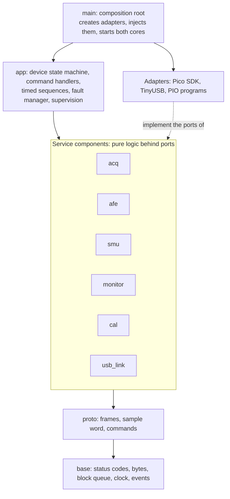
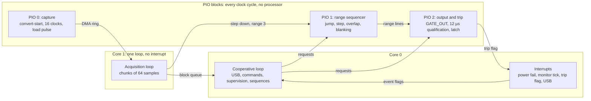
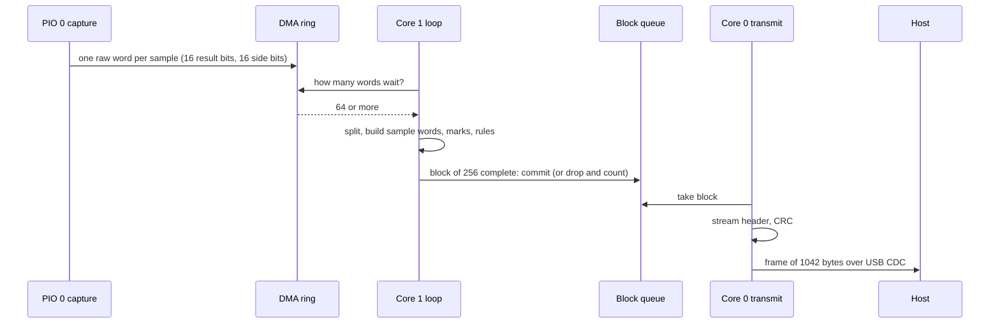

# Firmware Architecture

How the firmware is divided, what runs where, and how data moves from the
converter to the host. It refines section 6 of
[the specification](../specification.md) and changes nothing in it. This
is a design: nothing here is built or measured, and every figure that is
not quoted from the specification is an estimate.

## Languages and Tools

| Part | Language | Reason |
| --- | --- | --- |
| Everything that runs on the processors | C11, built with CMake and the Pico SDK | Sections 6 and 18.1 of the specification; the existing core and its tests are C11 |
| Acquisition, range sequencer, over-current trip | PIO programs | They act in every cycle of the 150 MHz clock, whatever the processors do (D-40) |
| Protocol generator, host package, tools | Python | They run on the PC only |

No interpreter runs on the controller: the sample rate, the USB throughput
and the reaction times of section 6.6 leave no room for one.

## Layers



- Dependencies point downward. `base` and `proto` are usable by all.
  Among the service components only `app` calls across them, and only
  `cal` writes flash (section 6.1).
- Every component keeps its pure sources in `src/`, compiled for the PC
  and for the target from the same files, and its adapters in `port/`,
  compiled for the target only. Pure code includes no SDK header,
  allocates nothing and keeps its state in structures the caller owns.
- Only `main` knows both sides. It creates the adapters and hands them to
  the pure code as ports.

## Components

| Component | Pure logic | Adapter |
| --- | --- | --- |
| `base` | Status codes, byte order, block queue, time arithmetic, event flags, the pin table with its checks (F-4, F-5) | Clock from the system timer |
| `proto` | Frame codec and parser, sample word, stream payload, command envelopes (exists) | None |
| `acq` | Split of the raw word into result and side bits, sample word assembly, settling window, over-range and under-range marks, step-down rule, decimation, the block builder | Capture program in PIO 0, DMA ring, the loop of core 1 |
| `afe` | Transition tables of the range sequencer, range lock policy, the checks around the trip (F-19 to F-21), mode and output requests with their times (F-23 to F-27) | Sequencer in PIO 1, trip in PIO 2, the mode request pins, the two interrupt handlers |
| `smu` | DAC frame (F-6), set-point in codes (F-30), the rules F-31 to F-33 | SPI to the DAC, the enable pin |
| `monitor` | Scan schedule, scale of the eight channels (F-10, F-11), rails test (F-12), CC class (F-13), budget (F-14), thermal limit (F-15) | SPI to the monitor converter, the monitor timer |
| `cal` | Calibration record with version, identity and CRC; nominal fall-back; zero calibration (section 8, F-36) | Flash sector, chip identifier |
| `usb_link` | Transmit scheduler: responses and events before stream frames, one frame at a time | TinyUSB CDC ACM, host-open detection |
| `app` | Device state machine, command handlers, timed sequences (start, self-test, DUT power, source start and stop), fault manager, supervision, status record | Watchdog, LED, console |

## Ports

A port is a structure of function pointers with a context pointer, declared
by the component that needs it. The adapter implements it for the board, a
fake implements it for the tests, and `main` injects it.

| Port | Declared in | What the pure code asks | Fake in the tests |
| --- | --- | --- | --- |
| Clock | `base` | Time in microseconds since start | A clock that the test advances |
| Carrier pins | `afe` | Release every pin; drive SMU_ON, the two mode requests and the chip selects; read PWR_GOOD and VIN_OV | Records every write with its time |
| Sequencer | `afe` | Start and stop the programs; write the transition table; ask for one step down; force range 3; read the range lines | Model of the rules, or the real program in the emulator |
| Output and trip | `afe` | Ask for the output on with the qualification time; force it off; read and clear the trip latch | Same |
| Capture | `acq` | Start and stop; how many raw words wait; where they are; overrun flag | Recorded raw words |
| Range requests | `acq` | One step down; range 3 at once (called from core 1) | Counts the calls |
| Slow bus | `monitor`, `smu` | One transfer to the monitor converter or to the DAC | Model of both parts |
| Flash | `cal` | Read the record; erase and write it | A sector in memory |
| Identity | `cal` | The 64-bit chip identifier | A constant |
| Watchdog | `app` | Enable; reload; did it cause this start | Records the reloads |
| Link | `usb_link` | Bytes in, bytes out, room in the transmit buffer, host open | A pipe in memory |

The existing `pp_afe_port_t` has six calls and predates draft A2. The
ports above replace it.

## What Runs Where



| Context | Runs | Period or trigger | May block |
| --- | --- | --- | --- |
| PIO 0, one state machine | Acquisition timing of F-34 | 1500 clocks per sample | Never |
| PIO 1, one state machine | Range sequencer of F-16, F-17 | Every clock | Never |
| PIO 2, two state machines | Output switch and trip of F-18; GATE_OUT low while PWR_GOOD is low (F-7) | Every clock | Never |
| Core 1 loop | Raw words into sample words and blocks; step-down, under-range and over-range rules | Each 64 samples, 0.64 ms | Never; a full queue drops the block |
| Power-fail interrupt, core 0, highest priority, in RAM | F-7 and F-27: outputs low, state machines stopped, pins released | Edge of PWR_GOOD or VIN_OV | Never |
| Monitor tick, core 0 | One transfer on the slow bus; F-21 and F-33 comparisons | 125 µs (estimate, see below) | Never |
| Trip flag interrupt, core 0 | Sets an event flag | Trip | Never |
| Core 0 loop | USB stack, command handling, supervision and watchdog reload, timed sequences, transmit, LED | Free-running; each step bounded | Never |

Section 6.2 names seven tasks. Here they are the steps of the core 0 loop
(USB stack, commands, USB transmit, application), the monitor tick with
the supervision step (monitor), the power-fail interrupt (power fail) and
the loop of core 1 (acquisition). A real-time kernel can be put under the
loop steps later without changing the pure code; whether one is needed is
decided in phase 1 from measured latencies.

### Why a Monitor Tick

Three rules need times that a free-running loop cannot promise: 100 SPS on
each monitor channel and never faster on three of them (F-10), an output
that opens within 0.5 ms of 5.3 V (F-33), and a sequencer that does not
act found within 2 ms (F-21). One timer interrupt owns the slow bus:

- In each tick it finishes the transfer it started in the tick before and
  starts the next one. No transfer is waited for inside the interrupt.
- Even ticks belong to the fast reading of channel 0, which runs only in
  source mode with the output closed. Odd ticks belong to the scan of the
  eight channels, each at a fixed tick of the 10 ms cycle, and to the DAC
  writes, which queue behind them.
- The tick reads CMP_JUMP and GATE_R3 as pins and counts how long the
  first is high while the second is low (F-21).

With a tick of 125 µs the fast reading has a period of 250 µs and is
compared one tick later, 375 µs after the crossing at the latest
(estimate from the schedule, not measured). The schedule is pure logic and
is tested on the PC against a model of the two parts on the bus.

The supervision step of the loop evaluates every other rule on a complete
scan and reloads the watchdog only then (F-8): a loop that hangs is reset
even while the tick still runs.

## Data Path



1. The capture program shifts two pins into one word, the converter and
   the shift registers, so result and side bits cannot lose alignment
   (section 4.7). The result bits land on the even bit positions and the
   side bits on the odd ones.
2. DMA moves each word into a ring in RAM. Nothing interrupts a processor
   per sample.
3. Core 1 takes the words in chunks of 64 and writes sample words straight
   into the frame that waits in the block queue. A chunk of 64 keeps the
   reaction of the under-range rule inside the 2 ms of F-22: 100 samples
   are 1 ms, and the chunk that holds the hundredth is complete 0.64 ms
   later at the most. Section 6.3 evaluates the rules once per block of
   256, which is 2.56 ms; the difference is an open point of section 16
   and this is the recommended answer.
4. A queue slot is a whole frame: header, stream header, 256 sample words,
   CRC. Core 1 fills the samples, core 0 writes the two headers and the
   CRC and hands the bytes to the USB stack. The samples are copied once,
   into the buffer of the stack.
5. When the queue is full core 1 drops the block and counts it; the next
   frame reports the count (section 7.2). Acquisition never waits.

## Shared State

No lock exists in the firmware. Each piece of shared state has one writer.

| State | Writer | Readers | Mechanism |
| --- | --- | --- | --- |
| Sample blocks | Core 1 | Core 0 loop | Single-producer, single-consumer queue (exists, tested with two threads) |
| Acquisition settings: stream on, step-down count, range lock, settling window | Core 0 loop | Core 1 | One atomic word per setting, taken at a block boundary |
| Event flags: trip, power fail, VIN over-voltage, sequencer fault, external voltage, scan complete | Interrupts | Core 0 loop | Atomic set in the interrupt, atomic take in the loop |
| Monitor scan | Monitor tick | Core 0 loop | Two snapshots and an index; the loop reads the finished one |
| Requests to the sequencer and to the trip | Core 0 loop and core 1 | PIO | Hardware FIFO and registers of the PIO block |
| Device state, faults, sequences | Core 0 loop | Core 0 loop | Plain data, one context |

An interrupt never calls the device state machine. It makes the hardware
safe, sets a flag and returns; the loop turns the flag into a fault.

## Budgets

Targets of section 6.3, with the estimates of this design. None is
measured; phase 1 measures them.

| Item | Target | Estimate of this design |
| --- | --- | --- |
| Acquisition loop on core 1 at 100 kSPS | Below 30 % | About 30 cycles per sample for split, marks and rules, 2 % of the core |
| Ring between the cores | 64 blocks, about 66 kB, 164 ms | 64 slots of 1044 bytes, 67 kB |
| DMA ring | Not stated | 2048 raw words, 8 kB, 20 ms |
| Sample to host | Below 20 ms typical | One block, 2.56 ms, plus the USB stack |
| USB payload | 400 kB/s plus headers; 500 kB/s or more sustained | 407 kB/s at 390.6 frames per second |
| Monitor tick | Not stated | 8000 interrupts per second of a few microseconds each |
| Power-fail reaction | 50 µs (F-7) | Interrupt entry and about twenty register writes |
| Jump comparator to GATE_R3 | 100 ns (F-16) | 11 clocks or fewer by count, 73 ns, plus the pads |
| Flash writes | Never while streaming or with a path closed | Refused by `cal` unless the state is IDLE |

## Design Patterns

Section 18.1 lists six patterns. The design uses them as follows and adds
five.

| Pattern | Where | Reason |
| --- | --- | --- |
| Ports and adapters | Every component | Logic is tested without hardware |
| Dependency injection | Ports handed over by `main` | Fakes and the emulator replace hardware |
| Table-driven state machine | Device states; accepted commands per state | Every transition is listed, reviewed and tested |
| Single-producer, single-consumer queue | Blocks between the cores | No lock in the real-time path |
| Incremental parser | Command frames from USB | Bytes arrive in arbitrary chunks |
| Sequence as data | Start, self-test, DUT power on and off, source start and stop | The order and the times of a rule are one table that a test reads back line by line |
| Command table | Command code to handler, with the states that accept it | The rules of section 7.4 are data, the same ones the host simulator follows |
| Policy and mechanism | Range sequencer: the program holds the timing, a table written by firmware holds the transitions | Lock, automatic ranging and range 3 on request need no second program |
| Observer | State machine to the event sender and the indicator | The machine knows nothing about USB |
| Fail-safe default | Fault manager: output off first, cause second, report third | One path for every fault (section 6.4) |
| Snapshot | Monitor scan, status record | A reader never sees half a scan |

## Layout and Builds

```text
firmware/
  CMakeLists.txt            Pico SDK project
  main/                     composition root, the two core entries
  components/<name>/
    include/<name>/         public headers, ports included
    src/                    pure C11
    port/                   Pico SDK adapters, PIO programs
    sources.cmake           pure sources and dependencies, for both builds
  test/
    host/                   unit tests on the PC (Unity), fakes, PIO emulator
    target/                 test application for the controller
```

Two builds read the same `sources.cmake` of every component:

- The host build compiles the pure sources with a native compiler and
  runs the unit tests.
- The target build compiles the same sources for the RP2350 with the
  Pico SDK and the ARM compiler and produces a `.uf2` image. It exists
  since 2026-10-12 with a composition root that starts the console and
  the state machine; the adapters join it as they are written.

## Tests

| Level | What it proves | Where | Needs |
| --- | --- | --- | --- |
| Unit | Every pure module, every rule of section 6.6 that is logic | `test/host`, Unity | PC |
| Contract | The codec reproduces the shared protocol vectors byte for byte | `test/host` | PC |
| Sequence | Start, DUT power and source sequences against the text of the rules, with a fake that records order and time | `test/host` | PC |
| PIO | The three programs cycle by cycle: timing of F-34, reaction of F-16 from every state, blanking of F-17, qualification of F-18 | `test/host`, emulator | PC |
| Link | The firmware core answers the host package: commands, events, stream, resynchronization | Host tests against the core built as a library | PC |
| Integration | The image on a Pico 2: capture, USB throughput, reaction times | `test/target` | Pico 2, phase 1 |
| System | The verification plan of section 11 | Bench | Carrier board |

The gates of section 18.3 hold for every level that runs on the PC:
warnings as errors, coverage of the pure code at 90 % of lines and 80 % of
branches or more, clang-format, clang-tidy and cppcheck clean. The
sanitizer builds run on Linux only.

A test never shows timing on hardware. The emulator counts clocks; pad
delays, comparator delays and interrupt latency are measured in phase 1.
