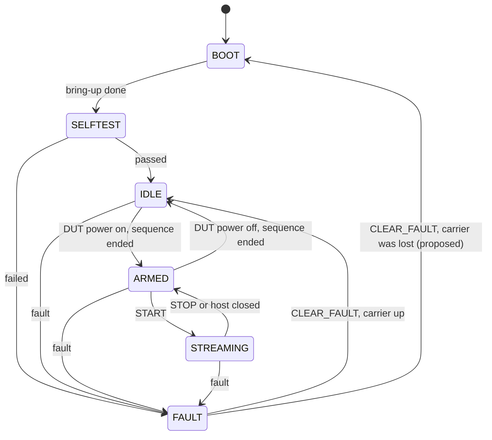
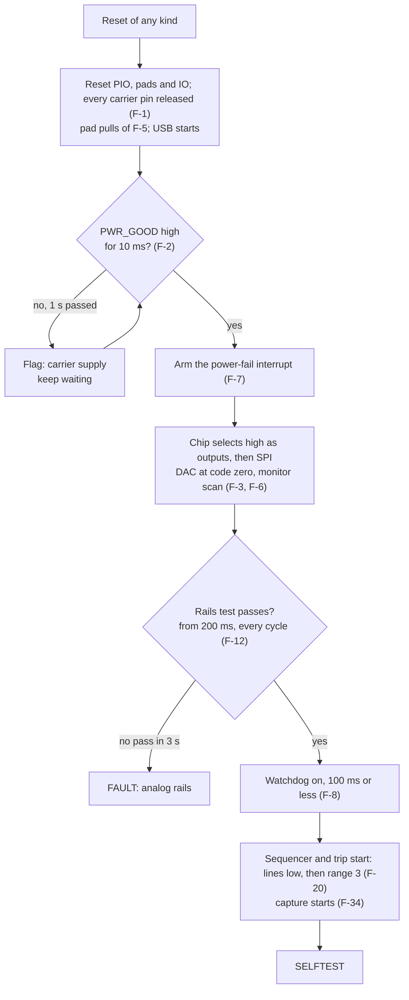
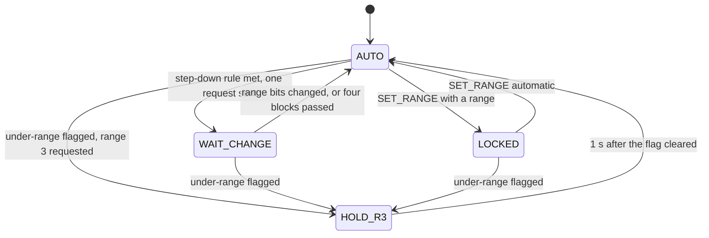

# State Machines and Sequences

The device state machine of section 6.4 of
[the specification](../specification.md), the timed sequences behind its
transitions, the fault manager and the supervision cycle. The three PIO
programs have [a page of their own](pio-programs.md). Rules are named by
their number in section 6.6.

This is a design. The table of today's code has six states and ten events;
what this page adds is marked as proposed until the owner decides the open
points of section 16.

## Device States

| State | What holds in it | Commands beyond GET_INFO and GET_STATUS |
| --- | --- | --- |
| BOOT | Pins released until PWR_GOOD is valid; then the bring-up of F-3 | Answer "busy" |
| SELFTEST | Programs running, every path open; the checks below | Answer "busy" |
| IDLE | Output and both mode pairs open, SMU_ON low, DAC at zero, range 3 selected | SET_MODE, SET_VOLTAGE, SET_RANGE, SET_DOWN_N, CAL_ZERO, CAL_READ, CAL_STORE, DUT_POWER on |
| ARMED | The path of the mode is closed and the output is on | SET_VOLTAGE, SET_RANGE, SET_DOWN_N, CAL_READ, START, DUT_POWER off |
| STREAMING | As ARMED, with stream frames | SET_VOLTAGE, SET_RANGE, SET_DOWN_N, CAL_READ, STOP |
| FAULT | Output off; what else is open depends on the cause | CLEAR_FAULT; the others answer "fault active" |

The states and their numbers are those of the protocol (section 7.4). The
table of accepted commands is data in `app`, the same rules the device
simulator of the host package follows.

### Transitions That Take Time

DUT power on takes 0.4 s in source mode and up to 3.3 s in ampere mode.
The protocol has no state for that, and none is added:

- The state stays IDLE while the sequence runs. A sequence is one busy
  flag beside the state: every command except the two queries answers
  "busy" while it is set.
- The response to DUT_POWER is sent when the sequence ends: OK, followed
  by the event "state changed" to ARMED, or "fault active" after the
  fault event when a check failed. F-24 names this instant as the result
  of DUT_POWER.
- DUT power off opens the output at once, then runs the rest of the stop
  sequence, answers and announces IDLE.

The host has to wait for that response for a few seconds. That is a fact
for the host client, not a change of the protocol.

### Proposed Additions to Section 6.4

Section 16 lists two points that the diagram of section 6.4 does not
answer. Recommended, and not decided:

- A fault while firmware waits in BOOT. The state stays BOOT. The flag
  "carrier supply" is set after 1 s without PWR_GOOD (F-2) and announced
  with a fault event; it is in the status record like every flag and
  clears when the bring-up ends. Nothing can be commanded meanwhile, which
  "busy" already says.
- PWR_GOOD lost after BOOT. The interrupt makes the pins safe (F-7), and
  the loop raises the fault "carrier supply": the state is FAULT. On
  CLEAR_FAULT the machine goes to BOOT instead of IDLE, because the
  bring-up has to run again, and from there to SELFTEST and IDLE as after
  a start. This is the one new transition.
- A watchdog restart passes BOOT and SELFTEST and ends in IDLE with its
  flag set (F-8). The flag is a report and not a reason for FAULT: it is
  cleared by CLEAR_FAULT, which answers OK in IDLE and changes nothing
  else.

## Start

The order is one sequence table. A unit test reads it back against F-1 to
F-3, F-8 and F-20: nothing is driven before PWR_GOOD is valid, the chip
selects are outputs before the bus is, the watchdog is on before the first
gate line moves.

## Self-Test

| Step | Check | Fails as |
| --- | --- | --- |
| 1 | The rails test of F-12 still passes | Self-test |
| 2 | The converter answers: with every switch open the codes of range 3 lie near the pedestal and are neither 0 nor 65535 | Self-test |
| 3 | The sequencer steps: range 2, 1, 0 and back to 3 on request, and the range bits of the samples follow each time | Self-test |
| 4 | The trip rests: the latch is clear and GATE_OUT reads low | Self-test |
| 5 | Start-up zero of every range with the output open, once channel 6 is stable and 200 ms after the reset, 5 s after PWR_GOOD at the most (F-36) | Self-test |

The limits of step 2 and the meaning of "stable" in step 5 are constants
to be fixed with the first board. A failed step raises the fault
"self-test" with the number of the step in the console log.

## DUT Power On

Both sequences start from IDLE and are refused, with "wrong state" or
"fault active", unless: PWR_GOOD is valid, the output and both mode pairs
are open, 5 ms have passed since a mode request fell (F-23), and 100 ms
have passed since the last trip (F-19).

### Source Mode (F-28, F-24, F-20)

| Step | Action | Then wait | Check |
| --- | --- | --- | --- |
| 0 | None | None | Channel 7 inside its window, SMU_ON low |
| 1 | DAC to the code of 0.80 V | 200 ms | None |
| 2 | SMU_ON high | 5 ms | None |
| 3 | DAC to the working value | 80 ms | None |
| 4 | Range 3 forced; trip armed 2 µs after the last gate change; GATE_SRC high | 60 ms | Channel 0 within 100 mV of the set-point, or the fault "start check" |
| 5 | Output on, through the trip program | 50 ms | No trip, or the fault "start over-current" |
| 6 | Automatic ranging released; state ARMED | None | None |

No other code path sets SMU_ON. The unit test of F-28 runs this table
against a fake that records every call with its time and compares order
and waits with the text of the rule.

### Ampere Mode (F-26, F-25, F-20, F-24)

| Step | Action | Then wait | Check |
| --- | --- | --- | --- |
| 0 | None | None | VIN_OV low; channel 1 inside 0.6 V to 5.4 V for the last 100 ms, or the fault "VIN out of range" |
| 1 | Range 3 forced; trip armed | Up to 3 s | Channel 0 below channel 1 plus 0.1 V, or below 0.3 V; otherwise the fault "start check" |
| 2 | GATE_AMP high | 40 ms | VIN_OV still low |
| 3 | Output on, through the trip program | 50 ms | No trip |
| 4 | Automatic ranging released; state ARMED | None | None |

The supervision cycle keeps "VIN valid for 100 ms" up to date in ampere
mode, so step 0 is a reading and not a wait.

## DUT Power Off (F-23, F-29, F-31)

| Step | Source mode | Ampere mode |
| --- | --- | --- |
| 1 | If channel 0 is more than 0.3 V above the DAC value: DAC to the reading minus 0.2 V, 30 ms | None |
| 2 | Output off | Output off |
| 3 | GATE_SRC low | GATE_AMP low |
| 4 | SMU_ON low, then DAC to zero | None |
| 5 | 5 ms before any mode request; state IDLE | 5 ms; state IDLE |

Readings with the output open (zero calibration, leakage) wait 200 ms
after step 2 (F-36).

## Faults

One function handles every fault, in this order: make the hardware safe,
record the cause, change the state, tell the host. The first step is the
same for all: the output is forced off through the trip program. A fault
found in an interrupt has that step done there.

| Cause | Rule | Found by | Within | After the output is off |
| --- | --- | --- | --- | --- |
| Over-current trip | F-18, F-19 | Trip program | 12 µs in range 3 | Range 3 stays; source stopped as F-29; DUT power refused for 100 ms; trips counted |
| Start over-current | F-19 | The same, within 100 ms of GATE_OUT | As above | As above, reported under its own name |
| Sequencer not acting | F-21 | Monitor tick: CMP_JUMP high, GATE_R3 low | 1 ms seen, off by 2 ms | Path opened as in DUT power off |
| Reverse current | F-22 | Core 1: code below 650 in range 3 for 100 ms | 100 ms | Path opened |
| Carrier supply | F-2, F-7 | Power-fail interrupt | 50 µs | Every output low, then released; state machines stopped; bring-up again |
| Analog rails | F-3, F-12 | Supervision cycle | 10 ms | Both mode pairs open, then SMU_ON low |
| VIN over-voltage | F-27 | Power-fail interrupt | Interrupt latency | GATE_AMP low for 5 ms or more |
| VIN out of range | F-26 | Supervision cycle | 20 ms | GATE_AMP low |
| Power limit | F-14 | Supervision cycle, 10 ms average | 10 ms | Path opened |
| Thermal limit | F-15 | Supervision cycle | 100 ms | Source pair open, then SMU_ON low |
| Source overload | F-32 | Supervision cycle | 20 ms | Path opened |
| External voltage | F-33 | Monitor tick, fast reading | 0.5 ms | Path opened |
| Start check | F-25, F-28 | Power-on sequence | At its step | Sequence undone in the stop order |
| Self-test | Section 6.4 | Self-test | At its step | Every path stays open |
| Watchdog restart | F-8 | Start | At start | Report only; state IDLE |

Since version 2 of the protocol every cause has a fault flag of its own
(D-103, [USB and host integration](usb-integration.md)). A trip within
100 ms of GATE_OUT sets two of them, over-current and start
over-current.

## Supervision Cycle

Once per complete scan of the monitor, every 10 ms, in the loop of core 0:

1. Which input supplies, and the 5 V rail (F-11).
2. Rails test (F-12). The power-limit case of a low rail goes to step 4.
3. CC class after three equal classifications (F-13).
4. Budget: input current and rail as 10 ms averages (F-14).
5. Thermal limit (F-15).
6. In ampere mode: VIN window and its 100 ms history (F-26).
7. In source mode: set-point settled, DUT above the set-point, overload
   (F-30, F-31, F-32).
8. Counters from core 1: under-range time in range 3 (F-22), dropped
   blocks.
9. Board temperature against the last zero: a new open-switch zero when
   the output is off and it moved by more than 2 °C (section 8).
10. Samples flagged for 5 ms when the supplying input changed or the rail
    stepped by more than 0.3 V (F-35): a request to core 1.
11. Events to the host for what changed.
12. Watchdog reload (F-8). Nothing else reloads it.

Each step is a pure function of the scan, the settings and its own small
state. The cycle is tested on the PC by feeding scans.

## Range Rules on Core 1

Per sample, from the side bits and the code:

| Mark or request | Condition | Rule |
| --- | --- | --- |
| Invalid | Seven samples from the first whose range bits differ from the sample before; every change restarts the count | F-35 |
| Invalid | For 5 ms on request of the supervision cycle | F-35 |
| Over-range | Code 65535, or the CMP_JUMP bit of the sample set | F-35 |
| Under-range | Code below 650 for 100 samples while a mode pair is closed | F-22 |
| Fault | From the first sample whose output bit is 0 once the trip latch is set | Section 7.3 |

- AUTO evaluates the step-down rule of section 4.4: N consecutive samples
  below the threshold of the range, N from SET_DOWN_N. It exists in the
  core and gains one input, the hold of HOLD_R3.
- HOLD_R3 asks for no step down. If the code stays below 650 in range 3
  for 100 ms, core 0 raises the reverse-current fault.
- LOCKED walks to the locked range and stays. The jump comparator, the
  trip and the under-range rule act as in AUTO.
