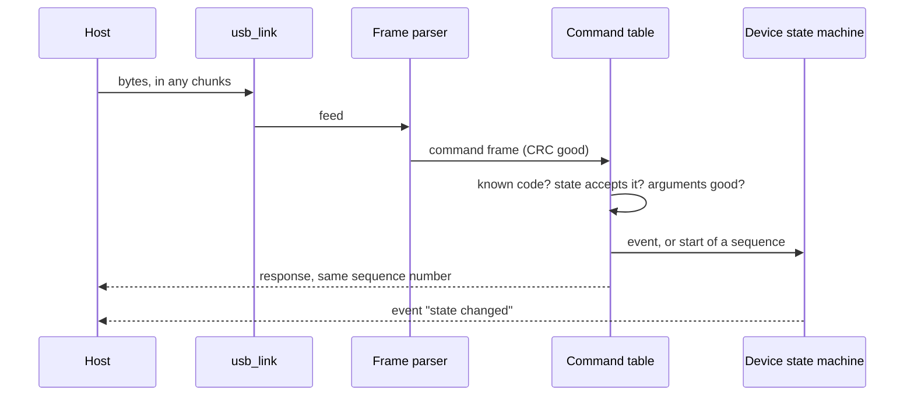
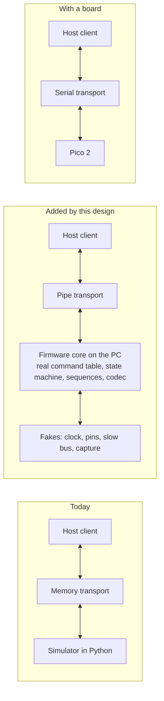

# USB and Host Integration

How the firmware and the host package meet: the USB link, the frames on
it, what version 2 of the protocol of section 7 of
[the specification](../specification.md) added for draft A2, and how the
two sides are tested against each other before a board exists.

Status: the link is a design. Version 2 of the protocol is decided
(D-103, 2026-10-12) and is in the definition, in both codecs and in
their tests; no firmware sends its fields yet.

## The Link

- One USB Full-Speed device with one CDC ACM function, on the TinyUSB
  stack that the Pico SDK brings (section 6.5). The host sees a serial
  port; baud rate and framing settings are ignored.
- The configuration descriptor declares 500 mA (F-14).
- The host has the port open while it holds DTR. When it drops, the stream
  stops and STREAMING falls back to ARMED (section 6.4); the output stays
  as it is.
- All bytes are frames of section 7.1. The console is not on USB: it is
  the UART of GP0 and GP1.

## Transmit

Three kinds of frame leave the device, through one writer in the loop of
core 0:

| Kind | Size | Source | Priority |
| --- | --- | --- | --- |
| Response | 12 bytes plus data | Command handlers | First |
| Event | 11 bytes plus data | State machine, fault manager, supervision | Second, in the order raised |
| Stream | 1042 bytes | Block queue | When nothing above waits |

- A frame is written whole or not started: the writer keeps its position
  in the frame it is sending and takes the next one only when that one is
  out. Frames never interleave.
- A response to a command is sent before the event that the command
  caused (section 7.4).
- At 100 kSPS the stream is 390.6 frames per second, 407 kB/s. Section 6.5
  asks for 500 kB/s sustained and, if a measurement shows less, for
  samples packed into 3 bytes; phase 1 measures it.
- When the stack has no room, blocks wait in the queue; when the queue is
  full, core 1 drops the newest block and the next frame carries the
  count. Responses and events have a buffer of their own and are not
  dropped.

## Receive

- The parser is incremental and resynchronizes on the magic word after a
  bad length or CRC (exists, tested).
- The command table holds, for every code, the handler, the argument
  size and the states that accept it. The order of the checks is the one
  of section 7.4: queries always, "busy" during start, "fault active" in
  FAULT, then the state, then the arguments.
- A command that starts a timed sequence is answered when the sequence
  ends ([State machines](state-machines.md)). One command runs at a time;
  a second one that arrives meanwhile answers "busy", the two queries
  excepted.

## Version 2 of the Protocol

Draft A2 reports more than version 1 of the protocol held. The project
owner decided on 2026-10-12 to add all of it in one step, while no
instrument and no capture exist (D-103). Section 7 of the specification
has the layouts; `protocol/definition.toml` decides every number.

### Sample Word

| Bit | Version 1 | Version 2 |
| --- | --- | --- |
| 18 | Invalid: settling window of a range change | The same, and the 5 ms after a change of the supplying input or a step of the 5 V rail (F-35) |
| 20 | Reserved | Over-range: code 65535 or the jump comparator set (F-35) |
| 21 | Reserved | Under-range (F-22) |
| 22 | Reserved | Output on: the GATE_OUT bit of the sample, from which the host counts the 250 ms of output settling (section 9) |
| 23 | Reserved | Reserved |

### Fault Flags

Version 1 had four flags. Version 2 has one for each cause of section 6.4:

| Bit | Flag | Rule |
| --- | --- | --- |
| 0 to 3 | Over-current, power limit, thermal, self-test | As in version 1 |
| 4 | Sequencer not acting | F-21 |
| 5 | Reverse current | F-22 |
| 6 | Carrier supply | F-2, F-7 |
| 7 | Analog rails | F-3, F-12 |
| 8 | VIN over-voltage | F-27 |
| 9 | VIN out of range | F-26 |
| 10 | Source overload | F-32 |
| 11 | External voltage | F-33 |
| 12 | Start check | F-25, F-28 |
| 13 | Start over-current, set together with bit 0 | F-19 |
| 14 | Watchdog restart | F-8 |

### Status, Information, Events and Calibration

| Item | Version 1 | Version 2 |
| --- | --- | --- |
| GET_STATUS | State, fault flags, dropped blocks: 7 bytes | 25 bytes: the same, then mode, locked range, set-point, VOUT, VIN, 5 V rail, temperature, supply in use, CC class, budget in mA, consecutive trips, a byte of notices |
| GET_INFO | Protocol version, hardware revision, firmware version: 5 bytes | 48 bytes: the same, then the state of the calibration, the settling window, the chip identifier, serial number and revision of the carrier, the four zero offsets |
| Budget | Event "power budget changed" in mW | Event "supply changed": supply in use, CC class, budget in mA (D-49); the old code is not used again |
| Notices | None | Event "notice": set-point settled (F-30), DUT above the set-point (F-31), new zero taken with its four offsets |
| CAL_ZERO | No data | Returns the four zero offsets, in 1/256 of a code |
| Calibration record | CAL_WRITE with one gain and one offset | CAL_READ and CAL_STORE carry the record of section 8 as one block of 250 bytes at the most; CAL_STORE in IDLE only; the code of CAL_WRITE is not used again |
| Constants taken from a board | No place | Fields of the record: offset of the VIN channel (F-26), thermal limit (F-15). The input model of F-14 waits for the first board |

What exists of it on 2026-10-12:

- The definition at version 2, with the layouts of the records as lists of
  fields. The generator derives the sizes and the offsets for C, the
  struct formats for Python and the shared vectors from them.
- Firmware: the sample word with its three new marks, one flag for each
  fault cause, and a codec for the four records
  (`firmware/components/proto/src/pp_report.c`), tested against the shared
  vectors.
- Host: the same in `protocol/sample.py` and `protocol/commands.py`, the
  simulator and the client with CAL_READ and CAL_STORE, and statistics
  that leave over-range and under-range samples out.

What does not exist: firmware that fills these fields, the component that
stores the calibration record, and the host tool that builds one.

## Tested Together Without Hardware

- The firmware core is built for the PC as a small program, the device
  twin, that reads and writes frames on its standard streams. Its ports
  are the fakes of the unit tests plus a plain model of what stands
  behind them: the monitor follows the set-point, the capture gives a
  synthetic current, time advances on request.
- The host package gains one transport that starts this program and
  talks to it. It implements the `Transport` interface that exists; the
  client does not change.
- One list of scenarios is run against both device sides, the simulator
  in Python and the twin: every command in every state with the status
  section 7.4 gives, the events in their order, a stream with a dropped
  block, a corrupted frame. Where the two differ, one of them or the
  specification is wrong.
- The same scenarios run against a Pico 2 through the serial transport,
  in the group of tests that need the instrument.

What this cannot show: throughput, latency and anything of the USB stack.
Those are measurements of phase 1.
